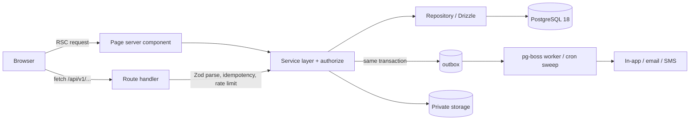
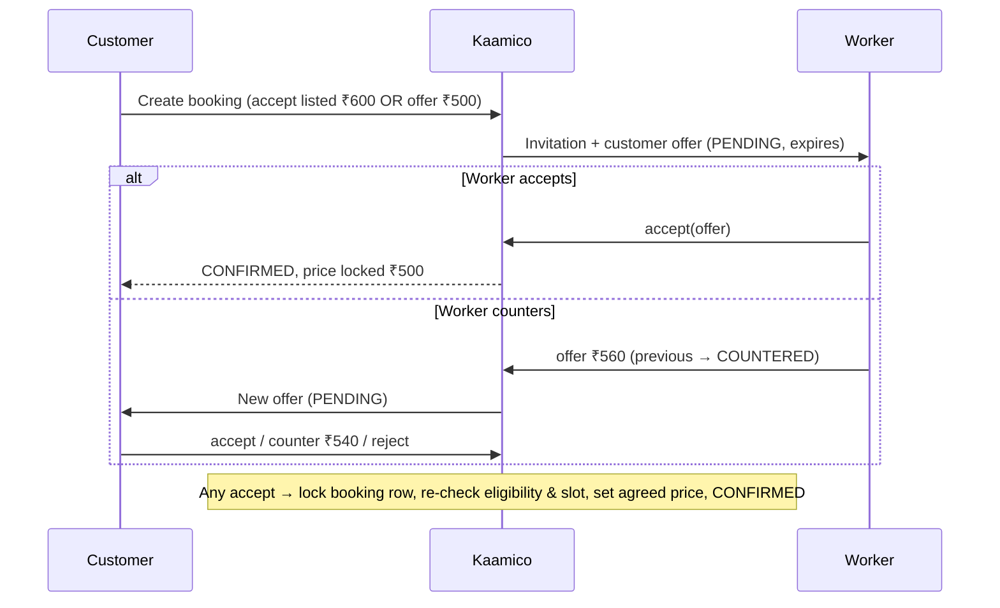
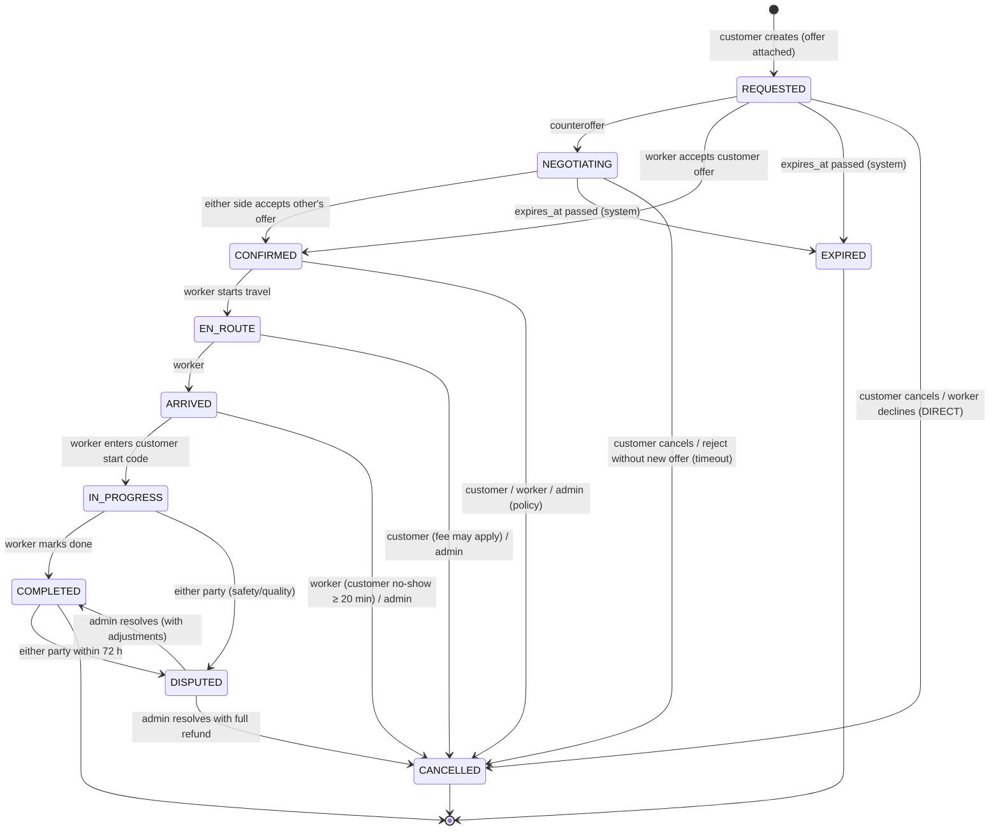

# Kaamico — Implementation Plan

> **Kaamico — Local Skills. Fair Prices.**
> A hyperlocal marketplace for on-demand and scheduled household services in India, where workers set their own prices and customers can negotiate openly.

| | |
|---|---|
| Status | **Planning only. Nothing has been implemented.** Development starts after explicit approval. |
| Plan date | 2026-10-25 |
| Repository | `Saakar22/Kaamico` (local: `Desktop\Saakar\Kaamico\Kaamico`) |
| Labels used | **[Fact]** verified by inspection · **[Rec]** recommendation · **[Assume]** assumption to confirm |

---

## Table of contents

1. [Executive summary](#1-executive-summary)
2. [Repository reconnaissance findings](#2-repository-reconnaissance-findings)
3. [Functionality matrix (existing / incomplete / missing / verify)](#3-functionality-matrix)
4. [Product requirements and user journeys](#4-product-requirements-and-user-journeys)
5. [Route and screen inventory](#5-route-and-screen-inventory)
6. [Urban Company-inspired UX analysis and differentiation](#6-urban-company-inspired-ux-analysis-and-differentiation)
7. [Brand identity and design system](#7-brand-identity-and-design-system)
8. [Technical architecture and technology decisions](#8-technical-architecture-and-technology-decisions)
9. [Database design](#9-database-design)
10. [API specification](#10-api-specification)
11. [Core algorithms and business rules](#11-core-algorithms-and-business-rules)
12. [Shared UI component architecture](#12-shared-ui-component-architecture)
13. [External integrations and configuration](#13-external-integrations-and-configuration)
14. [P0 / P1 / P2 prioritization](#14-p0--p1--p2-prioritization)
15. [Phase-by-phase implementation roadmap](#15-phase-by-phase-implementation-roadmap)
16. [Testing and deployment strategy](#16-testing-and-deployment-strategy)
17. [Risks, assumptions and unresolved decisions](#17-risks-assumptions-and-unresolved-decisions)
18. [Final acceptance checklist](#18-final-acceptance-checklist)

---

## 1. Executive summary

**What Kaamico is.** Kaamico is a two-sided marketplace. It connects households in Indian cities with nearby plumbers, electricians, painters, carpenters, cleaners, cooks, house helps and other local workers, for jobs that are needed now or booked for later. It borrows Urban Company's proven booking usability: category browsing, clear prices, booking status and trust signals. It differs in three ways:

1. **Workers set their own prices.** Kaamico does not set a platform rate card. Each worker sets a price and a minimum charge for each service.
2. **Negotiation is open and recorded.** The customer can accept the listed price or make an offer, and the worker can counter. Every offer is kept in an append-only history. When the booking is confirmed, the agreed price is locked in the database. Any additional charge needs the customer's explicit approval.
3. **Hyperlocal and fair.** Customers see eligible, available workers near them. New workers get guaranteed exposure. Commission is low and shown openly to workers.

**Repository state [Fact].** The repository is **empty**: no commits and no files, locally or on GitHub. Everything in this plan is greenfield. There is no existing code to preserve, so the "preserve existing code" requirement applies to the tooling already on this machine (Node 24.22.1, PostgreSQL 18.4, Java 25, Docker Desktop).

**Key decisions [Rec].**

| Area | Decision |
|---|---|
| Architecture | Modular monolith in **one Next.js (App Router) + TypeScript** application, with domain modules in `src/modules/*` |
| Data | **PostgreSQL 18** (already installed and running locally) with **Drizzle ORM**. Money is stored as **integer paise**. Integrity is enforced by the database through check constraints, partial unique indexes, a `btree_gist` exclusion constraint against double booking, and immutability triggers. |
| API | Versioned **REST route handlers** at `/api/v1/*` on top of a framework-independent service layer, plus Zod-validated contracts shared with the UI |
| Auth | **Phone OTP** (passwordless) for customers and workers, **email + password** for admins. **Decided in Phase 4:** our own opaque database sessions (the documented fallback), because the Better Auth spike showed it needs placeholder emails for phone-only users. OTP is **simulated** locally. |
| Geo | Latitude/longitude columns with a bounding-box prefilter and Haversine distance. "Distance" is always shown as straight-line distance. Arrival is shown as a labelled estimate range, never a promise. PostGIS is deferred because it is not installed locally. |
| Real-time | Polling with TanStack Query in P0, server-sent events in P1 |
| Payments | P0: cash-on-completion plus a **clearly labelled simulated** online payment. P1: Razorpay test mode. |
| Storage | Private storage behind an interface: local disk outside `public/` in development, an S3-compatible bucket in the Mumbai region in production. Identity documents are served only through short-lived, audited URLs for admins. |

**MVP scope (P0).** One complete, reliable journey for each role. Customer: find, compare, request, negotiate, confirm, track, complete, pay (cash or simulated), review. Worker: onboard, verify, price, set availability, quote, execute, see earnings. Admin: approve verification, oversee bookings, see the audit trail. The demo runs entirely locally with seeded data and no paid services.

**Effort [Assume one full-stack developer].** About 38–48 developer-days for P0, plus about 15–22 for the core of P1. Ranges, not promises (see §15).

---

## 2. Repository reconnaissance findings

### 2.1 What was inspected

| Check | Result |
|---|---|
| Working tree `Kaamico/` | **[Fact]** Only `.git/` exists. There are no source files, README, manifests, lockfiles, configs, env examples, tests or docs. |
| Git history | **[Fact]** `main` has no commits ("No commits yet"). `origin/main` is shown as `[gone]`. |
| Remote `https://github.com/Saakar22/Kaamico` | **[Fact]** Public, `size: 0`, created 2026-10-24. `git ls-remote` returns no refs. |
| Sibling folder `Kaamico/rea/` | **[Fact]** A separately cloned third-party reverse-engineering tool (REA). **It is not part of Kaamico and must not be committed to the Kaamico repo.** |
| Pages, routes, components, styling, backend, DB schema, ORM, auth, integrations, tests, CI, deployment | **[Fact]** None exist. |
| Secrets / env files | **[Fact]** None exist, so nothing needed redacting. |

### 2.2 Development environment (relevant tooling found on this machine)

| Tool | Status | Implication |
|---|---|---|
| Node.js | **[Fact]** 24.22.1 (LTS line), npm 11.19.1 | Pin `"engines": {"node": ">=24.22 <25"}` and add `.nvmrc` with `24` |
| PostgreSQL | **[Fact]** 18.4, Windows service `postgresql-x64-18` **running** | Use it directly for development and tests; no Docker needed |
| `btree_gist` extension | **[Fact]** Available | Allows the exclusion constraint against double booking (§9.4) |
| PostGIS | **[Fact]** **Not installed** | P0 geo uses latitude/longitude columns with Haversine; PostGIS is optional later |
| Docker Desktop | **[Fact]** Installed, daemon **not running** | Optional; can be used later for Testcontainers or PostGIS |
| Python 3.14, Java 25, Git | **[Fact]** Present | Not needed by Kaamico |
| pnpm / yarn / bun / Redis | **[Fact]** Not installed | Use **npm** (already present). Avoid Redis in P0. |
| GitHub CLI `gh` | **[Fact]** Not authenticated | CI setup and PR creation need `gh auth login` (Phase 1) |
| Location of repo | **[Fact]** Inside a **OneDrive-synced** folder | **Risk:** OneDrive syncing `node_modules/` and `.next/` causes slowness and `EPERM` file locks. Recommend moving the repo outside OneDrive (e.g. `C:\dev\kaamico`) before Phase 1, or excluding those folders. |

### 2.3 Conclusion

There is no existing implementation to assess, extend or rewrite. The plan therefore defines the architecture from first principles and chooses technologies that already fit the installed toolchain (npm, Node 24, local PostgreSQL 18). It avoids anything that needs paid credentials for a local demo.

---

## 3. Functionality matrix

| Category | Items |
|---|---|
| **A. Existing and functional** | *None.* The repository has no files. |
| **B. Existing but incomplete** | *None.* |
| **C. Missing (all required)** | Everything: project scaffold, design system, database and migrations, seed data, authentication and roles, catalog, location, search and matching, professional profiles, worker onboarding, verification, pricing and availability, booking lifecycle, negotiation, tracking, dashboards for all three roles, reviews, notifications, payments, invoices, earnings ledger, support and disputes, admin console, audit log, tests, CI, deployment |
| **D. Requires verification later** | (1) Better Auth phone-OTP plugin behaviour with the chosen Next.js version (Phase 4 spike). (2) Drizzle support for every constraint we need, falling back to raw SQL migrations (Phase 3). (3) Razorpay test-mode onboarding requirements for the account holder (P1). (4) GST/TCS treatment of marketplace invoices; needs a chartered accountant before real money. (5) SMS OTP delivery, which needs TRAI DLT registration for production. |

---

## 4. Product requirements and user journeys

### 4.1 Roles and capability summary

| Role | P0 capabilities | P1+ |
|---|---|---|
| **Customer** | Phone OTP sign-in; set location (preset locality, saved address or browser geolocation); browse and search; compare professionals; view profile; request on-demand or scheduled booking; accept listed price or counteroffer; confirm; track status timeline; approve or reject extra charges; cancel per policy; pay cash or simulated; review; saved addresses; booking history | Favorites, invoices as PDF, support tickets, disputes, Razorpay test payments, notification preferences |
| **Worker** | Phone OTP sign-in; onboarding wizard (profile, skills, service area); verification submission and status; per-service pricing and minimum charge; weekly hours and time off; online/paused toggle; request inbox; quote, counter, accept, decline; job execution status updates with a job start code; earnings ledger (simulated payouts) | Reviews and replies, payout requests, analytics, notification preferences |
| **Admin** | Email + password sign-in; metrics overview; verification queue with approve/reject/request-resubmission; document viewing through audited signed URLs; user and worker suspension; category and service management; booking inspection with full history; audit log | Disputes, refunds, review moderation, payments view, analytics |

**Authorization principle [Rec].** Every permission is enforced on the server inside the service layer (`authorize(actor, action, resource)`). Hiding a navigation link is cosmetic only. Middleware does coarse route gating (signed in, role prefix); services do the fine-grained ownership checks.

### 4.2 Customer journey (P0 path)

| # | Step / route | User action | Data | Frontend | Backend & DB | Validation / authz | Success | Failure & edge cases | Depends on |
|---|---|---|---|---|---|---|---|---|---|
| 1 | Home `/` | Opens site | Categories, top services in locality | Server-rendered category grid; location chip | `catalog.listCategories()`, `SELECT` active categories | Public | Grid shown | No categories (seed missing) → empty state with admin hint in dev | Catalog |
| 2 | Location sheet (modal on any page) | Picks locality, saved address or "use my location" | lat/lng, locality label | Bottom sheet on mobile, popover on desktop; stored in cookie `kmc_loc` | Signed in: optional `PATCH /me` default address; `localities` lookup | lat in [6, 37], lng in [68, 98] (India bounding box); geolocation permission | Chip shows locality | Geolocation denied → manual pick; outside service cities → "Not yet in your area" with waitlist (P2) | Location module |
| 3 | `/services` → `/services/[category]` | Browses category | Services with "workers nearby from ₹X" | Service cards with price range from current worker prices | `catalog.getCategory(slug)` + aggregated `MIN/percentile price` of eligible nearby workers | Public | List | Unknown slug → 404; no nearby workers → "No professionals nearby yet" + schedule-later CTA | Matching (counts) |
| 4 | `/search?service=…` | Compares professionals | Ranked candidates with distance, price, rating, badges, availability | Sort tabs (Recommended / Price / Rating / Distance); filter drawer; skeleton list | `matching.searchProfessionals()` (§11.1) | `serviceId` exists and is active; location required (else prompt) | Ranked list | Zero results → auto radius expansion, then show scheduled alternatives; stale availability → refresh on focus | Matching, pricing, availability |
| 5 | `/professionals/[id]` | Views profile | Bio, skills, verified badge, prices per service, reviews, next available slot | Sticky "Book" CTA (mobile bottom bar) | `professionals.getPublicProfile()`; never returns phone, exact location or documents | Worker must be VERIFIED and not suspended to be publicly visible | Profile | Suspended/unverified → 404 (no information leak) | Reviews |
| 6 | `/book/[serviceId]?worker=…` | Fills wizard: address → when (now/slot) → job details & photos (P1) → price (accept listed / make offer) → review | Address, slot, description, optional `customerOfferPaise` | 4-step wizard; state in URL and session storage; idempotency key generated at mount | `POST /api/v1/bookings` (transaction, §10.6) | Signed-in customer; worker eligible for service; slot inside worker hours and free; offer ≥ allowed floor; description ≤ 1000 chars | Booking `REQUESTED` → redirect to `/bookings/[id]` | Double-submit → same booking returned (idempotency); slot just taken → 409 with alternatives; worker went offline → offer "notify other nearby professionals" (P1 broadcast) | Auth, booking, negotiation |
| 7 | `/bookings/[id]/negotiate` | Reads worker quote; accepts / counters / rejects | Offer thread, messages, expiry timers | Chat-style thread with offer cards and countdowns; polling every 5 s | `POST /offers`, `POST /offers/:id/accept`; row lock on booking | Must be booking's customer; turn-taking rule; round limits; amount bounds | On accept → `CONFIRMED`, price locked | Offer expired → card disabled, "Ask for a new quote"; concurrent accept → 409, refetch | Negotiation engine |
| 8 | `/bookings/[id]` (confirmed view) | Sees confirmation, start code, worker contact (masked call P2) | Agreed price, slot, worker card, timeline, start code | "Confirmed" banner (after `?confirmed=1`), timeline component | `GET /bookings/:id` (customer-scoped projection) | Owner only; start code visible only to customer | Shown | Worker cancels → status `CANCELLED` with reason; customer offered rebook | Booking |
| 9 | `/bookings/[id]` (tracking) | Watches En route → Arrived → In progress | Status history | Timeline updates through polling | Worker transitions (§11.3) | — | — | No GPS in P0: tracking is **status-based** and labelled as such | — |
| 10 | Extra-charge prompt (on `/bookings/[id]`) | Approves or rejects materials/extra work | Charge description, amount, receipt photo | Blocking dialog with clear new total | `POST /charges/:id/approve` (tx, recompute total) | Customer owner; charge `PROPOSED` | New final amount | Rejected → worker continues at agreed price or raises a dispute | Charges |
| 11 | Completion → payment | Pays cash / simulated UPI | Final amount | "Pay ₹X" sheet; simulated payments show a **SIMULATION** badge | `POST /bookings/:id/payments`; ledger entries | Booking `COMPLETED`; idempotent | Payment `CAPTURED` / cash recorded | Simulated failure → retry; cash disagreement → dispute (P1) | Payments, ledger |
| 12 | `/bookings/[id]/review` | Rates 1–5 with tags and comment | Rating, tags, comment ≤ 1000 chars | Star input with large tap targets | `POST /bookings/:id/review` (unique per booking) | Customer owner; booking COMPLETED; within 14 days; not already reviewed | Review published; worker rating recomputed | Duplicate → 409; window passed → 422 | Reviews |

**Gaps that would break the journey if omitted:** location before search (step 2); the worker's pricing and availability must exist before step 4 (seed data covers the demo); the worker must respond (step 7) or the booking needs expiry (§11.2) so customers are not stuck; and there must be a completion step before payment and review.

### 4.3 Worker journey

| # | Step / route | Action | Data | Backend & DB | Validation / authz | Success | Failure / edge cases |
|---|---|---|---|---|---|---|---|
| 1 | `/login` → role choice | Signs in with phone OTP, picks "I offer services" | Phone, name | Create `users` (roles `{WORKER}`), `worker_profiles` (status UNVERIFIED) | E.164 Indian mobile `^\+91[6-9]\d{9}$`; OTP rate limits | Redirect `/worker/onboarding` | Phone already a customer → adds WORKER role to the same account |
| 2 | `/worker/onboarding` | Display name, photo, bio, languages, experience, skills (categories), base locality and radius | Profile fields, skill list | `PATCH /worker/profile`, `PUT /worker/skills`, `PUT /worker/service-area` | Radius 1–25 km; ≥1 skill; photo ≤ 5 MB JPEG/PNG/WebP | Checklist shows progress | Abandoned midway → resumes at first incomplete step |
| 3 | `/worker/verification` | Uploads ID proof (masked Aadhaar / PAN / voter ID / DL), selfie, optional skill certificate; submits | Files, ID type, last 4 digits only | Private storage; `verification_documents`; application `SUBMITTED` | MIME sniffing (not extension), size limits, max 6 docs; **never store full Aadhaar number** | Status "Under review" | Rejected → reason shown, resubmission allowed; resubmission creates a new application version |
| 4 | `/worker/pricing` | Sets price, unit and minimum charge per service; negotiable flag | Prices in ₹ (stored as paise) | `PUT /worker/pricing` | Price ≥ ₹50 and ≤ ₹1,00,000; min charge ≤ price × 3; only services within the worker's skills | Saved; future bookings use the new price | Existing bookings keep their snapshot price (immutability) |
| 5 | `/worker/availability` | Weekly hours, time off, online toggle | Rules per weekday, time-off ranges | `PUT /worker/availability`, `POST /worker/time-off`, `POST /worker/status` | End > start; ≤ 3 windows per day; time off cannot overlap a confirmed booking (warn and block) | Visible in search when VERIFIED + rules exist | No hours set → hidden from scheduled search; on-demand needs "online" |
| 6 | `/worker/requests` | Sees new requests (invitation cards with service, locality, distance, customer offer, slot) | Invitations | `GET /worker/requests` (own only) | Exact address hidden until confirmation | — | Expired invitations move to "Missed" |
| 7 | `/worker/requests/[id]` | Quotes / accepts customer offer / counters / declines | Amount, note | `POST /bookings/:id/offers`, `POST /offers/:id/accept`, `POST /worker/requests/:id/decline` | Worker must be the invitee, VERIFIED and not paused; slot still free (locked check) | On mutual acceptance → booking CONFIRMED and assigned | Customer accepted a different worker (broadcast, P1) → "Booked by another professional" |
| 8 | `/worker/bookings/[id]` | Start travel → Arrived → enter customer's 4-digit start code → In progress → propose extra charge (optional) → Complete | Status, start code, charges, completion note/photo (P1) | `POST /bookings/:id/transitions` with `expectedVersion` | Only the assigned worker; legal transitions only; start code must match (5 attempts max) | Booking COMPLETED; ledger entries created | Wrong code ×5 → locked, contact support; customer unreachable → worker may cancel with reason "no-show" after 20 min at ARRIVED |
| 9 | `/worker/earnings` | Views gross, commission, net, balance and payouts | Ledger entries | `GET /worker/earnings/summary`, `GET /worker/ledger` | Own data only | Clear breakdown; **"Payouts are simulated"** label in P0 | Cash jobs create a commission due (negative balance) — explained in UI |

### 4.4 Admin journey

| # | Route | Action | Backend & DB | Authz / audit | Edge cases |
|---|---|---|---|---|---|
| 1 | `/admin/login` | Email + password | Better Auth email sign-in; session flagged `ADMIN` | Role `ADMIN` required; rate-limited; generic error message | Locked after 10 failures in 15 min |
| 2 | `/admin` | Views KPIs: pending verifications, active bookings, today's bookings, cancellations, average response time | Aggregated `SELECT`s (cached 60 s) | Admin only | Empty DB → zero states |
| 3 | `/admin/verifications` | Filters queue (oldest first) | Paged query on `verification_applications` | Admin only | — |
| 4 | `/admin/verifications/[id]` | Opens documents, compares selfie to profile photo, checks details | `GET /admin/verification-documents/:id/url` → 5-minute signed URL | **Every document view writes `admin_audit_logs`** (`DOCUMENT_VIEWED`) | Two admins on the same application → optimistic `version` check on decision |
| 5 | Decision | Approve / reject (reason required) / request resubmission | `POST /admin/verifications/:id/decision` (tx: application + worker status + notification + audit) | Reason ≥ 10 chars for reject/resubmit | Already decided → 409 |
| 6 | `/admin/bookings/[id]` | Inspects booking, offer thread, status history, payments | Read-only joins | Admin only; offer thread visible for investigation | — |
| 7 | `/admin/disputes/[id]` (P1) | Reviews evidence, resolves (customer favour / worker favour / split / reject) | Tx: dispute → booking status → optional refund → ledger adjustment → audit | Reason required | Refund > captured amount → 422 |
| 8 | `/admin/audit-logs` | Reviews administrative actions | Append-only table | Admin only; no edit/delete API | — |

---

## 5. Route and screen inventory

**[Fact]** None of these routes exist yet; the "Exists" column is omitted because every value would be "No". File paths below are the **planned** locations in the Next.js App Router (`src/app/...`).

### 5.0 Conventions that apply to every route

- **Route groups:** `(public)`, `(customer)`, `(worker)` → `/worker/*`, `(admin)` → `/admin/*`, `(auth)`.
- **Guards:** `middleware.ts` does coarse gating (session present; role prefix). Each page's server component calls `requireRole()`; each API call re-checks ownership in the service layer.
- **States:** **Loading** uses `loading.tsx` with skeletons matching the final layout (no spinners for full pages). **Empty** uses `<EmptyState>` with an illustration, one sentence and one primary action. **Error** uses `error.tsx` with `<ErrorState>` (retry, plus support link with a correlation ID). **404** uses `not-found.tsx`. **Success** uses an inline toast; destructive or financial success gets a confirmation screen or banner.
- **Responsive:** mobile-first. Below `md` (768 px): bottom tab bar (role-specific) and sticky bottom CTAs. At `lg` and up: top navigation (customer) or left sidebar (worker, admin) with a 12-column grid.
- **Priority:** P0 = required for MVP demo; P1 = important next; P2 = future.

### 5.1 Public and customer routes

| Route (planned file) | Role | Purpose / main sections | Key components | Data & APIs | Route-specific states | Mobile vs desktop | Pri |
|---|---|---|---|---|---|---|---|
| `/` `(public)/page.tsx` | Public; personalised if signed in | Hero with location chip and search; category grid; "How fair pricing works" (3 steps); trust strip (verified, reviews, locked price); active booking card if signed in; worker recruitment CTA | `LocationChip`, `SearchBar`, `CategoryGrid`, `TrustStrip`, `ActiveBookingBanner` | `GET /categories`, `GET /bookings?active=1` | No location → prompt chip pulses | Mobile: stacked; desktop: hero two-column | P0 |
| `/services` | Public | All categories with services count and price-from | `CategoryCard` | `GET /categories` | — | 2 cols → 4 cols | P0 |
| `/services/[category]` | Public | Category header, service list with "from ₹X nearby", FAQs | `ServiceCard`, `PriceRange`, `Faq` | `GET /categories/:slug?lat&lng` | No nearby workers → schedule-later CTA; unknown slug → 404 | List → grid | P0 |
| `/search` | Public (booking needs sign-in) | Query + service filter; ranked professional list; sort tabs; filters (price ≤, rating ≥, available now, verified only is implicit) | `ProfessionalCard`, `SortTabs`, `FilterSheet`, `RadiusNotice` | `GET /search/professionals`, `GET /search?q=` | Radius expanded → `RadiusNotice` "Showing pros up to 8 km"; zero → alternatives | Filters in bottom sheet vs side panel | P0 |
| `/professionals/[id]` | Public | Header (photo, name, verified badge, rating, jobs done, languages), services and prices, availability preview, reviews, "about" | `ProfileHeader`, `VerificationBadge`, `ServicePriceList`, `AvailabilityPreview`, `ReviewList`, `StickyBookBar` | `GET /professionals/:id`, `/reviews`, `/availability` | Not public → 404 | Sticky bottom "Book" vs right rail card | P0 |
| `/book/[serviceId]` | Customer | Wizard: Address → When → Details → Price → Review & request | `Stepper`, `AddressPicker`, `SlotPicker`, `PriceDecision`, `BookingSummary` | `GET /addresses`, `GET /professionals/:id/availability`, `POST /bookings` | Slot conflict → inline alternatives; signed-out → `/login?next=` | Full-screen steps vs two-column with summary | P0 |
| `/bookings/[id]/negotiate` | Customer (owner) | Offer thread, current offer card with expiry, actions (Accept / Counter / Decline), short messages | `NegotiationThread`, `OfferCard`, `CounterOfferForm`, `CountdownBadge` | `GET /bookings/:id/negotiation`, `POST /offers`, `POST /offers/:id/accept|reject` | Expired, superseded, booking confirmed elsewhere → read-only with banner | Full screen chat vs panel beside booking summary | P0 |
| `/bookings/[id]` | Customer (owner) | Status timeline (tracking), worker card, agreed price + charges, start code, actions (cancel, pay, review, help) | `BookingTimeline`, `WorkerMiniCard`, `PriceBreakdown`, `StartCodeCard`, `ChargeApprovalDialog`, `CancelDialog` | `GET /bookings/:id` (poll 10 s while active) | `?confirmed=1` → confirmation banner (replaces the separate confirmation route) | Single column vs 8/4 split | P0 |
| `/bookings/[id]/review` | Customer (owner) | Stars, tags, comment | `RatingInput`, `TagChips` | `POST /bookings/:id/review` | Ineligible → explanation | — | P0 |
| `/bookings` | Customer | Tabs: Active / Upcoming / Past / Cancelled | `BookingListItem`, `Tabs` | `GET /bookings?status` (cursor) | Empty → "Book your first service" | — | P0 |
| `/dashboard` | Customer | Needs-your-action (offers awaiting reply, charges to approve), active booking, quick rebook, saved pros (P1) | `ActionInbox`, `ActiveBookingBanner`, `RebookCarousel` | `GET /me/dashboard` | Nothing pending → friendly empty | — | P0 |
| `/addresses` | Customer | List, add, edit, set default, delete | `AddressForm`, `AddressCard`, `MapPinPicker` (P1) | `/addresses` CRUD | Address used by active booking → cannot delete (soft delete after) | — | P0 |
| `/profile` | Customer | Name, phone (read-only), email (optional), language preference | `ProfileForm` | `GET/PATCH /me` | — | — | P0 |
| `/login` | Public | Step 1 phone → step 2 OTP (same route, step in state) → step 3 role choice for new users | `PhoneInput`, `OtpInput`, `RoleChoice` | Better Auth endpoints; `POST /me/onboarding` | Wrong OTP / expired / rate-limited messages; **dev banner shows simulated OTP** | — | P0 |
| `/favorites` | Customer | Saved professionals | `ProfessionalCard` | `/favorites` | Empty | — | P1 |
| `/payments` | Customer | Payment history, receipts | `PaymentRow`, `ReceiptLink` | `GET /payments` | — | — | P1 |
| `/notifications` | Customer | Notification list, mark read | `NotificationItem` (shared with worker) | `GET /notifications` | — | — | P1 |
| `/settings` | Customer | Notification prefs, language, delete account (DPDP) | `SettingsSection` | `PATCH /me/settings` | — | — | P1 |
| `/support` | Customer | Help topics, create ticket, my tickets, raise dispute from a booking | `TicketForm`, `TicketThread` | `/support/tickets`, `/bookings/:id/disputes` | — | — | P1 |
| `/register` | — | **Not needed**: OTP login creates the account (redirect to `/login`) | — | — | — | — | — |
| `/forgot-password`, `/verify-otp` | — | **Not needed** for customers/workers (passwordless; OTP is a step of `/login`). Admin password reset is `/admin/forgot-password` (P2). | — | — | — | — | — |
| `/bookings/[id]/confirmation`, `/bookings/[id]/track` | — | **Merged into `/bookings/[id]`**: confirmation is a state banner and tracking is the timeline. Separate routes would duplicate data loading and diverge. | — | — | — | — | — |
| `/about/fair-pricing`, `/become-a-professional`, `/terms`, `/privacy` | Public | Static content: explains negotiation and commission; worker recruitment; legal | `ContentPage` | — | — | — | P1 (privacy/terms text P0 placeholder) |

### 5.2 Worker routes (`/worker/*`, role WORKER)

| Route | Purpose / sections | Key components | APIs | Route-specific states | Pri |
|---|---|---|---|---|---|
| `/worker/onboarding` | Checklist wizard: profile → skills → service area → pricing → hours → verification | `OnboardingChecklist`, `Stepper`, `SkillPicker` | `/worker/profile`, `/worker/skills`, `/worker/service-area` | Resumes at first incomplete step | P0 |
| `/worker/verification` | Status card (UNVERIFIED / SUBMITTED / UNDER_REVIEW / APPROVED / REJECTED / RESUBMISSION_REQUESTED), document uploader, rejection reason, privacy note | `VerificationStatusCard`, `DocumentUploader` | `/worker/verification*` | Uploads disabled while under review | P0 |
| `/worker/dashboard` | Online toggle, today's jobs, new requests count, this week's earnings, onboarding/verification prompts | `OnlineToggle`, `JobCard`, `StatTile`, `ActionInbox` | `GET /worker/dashboard` | Unverified → hero explaining what remains | P0 |
| `/worker/requests` | Tabs: New / Negotiating / Missed (replaces separate `/worker/negotiations`) | `RequestCard`, `CountdownBadge` | `GET /worker/requests?state` | Paused → banner "You're paused; you won't get new requests" | P0 |
| `/worker/requests/[id]` | Request detail (service, locality, approximate distance, slot, customer offer, description), quote form, negotiation thread | `NegotiationThread` (shared), `QuoteForm`, `OfferCard` | `GET /worker/requests/:id`, offers APIs | Won → redirect to `/worker/bookings/[id]`; lost/expired → read-only | P0 |
| `/worker/bookings` | Tabs: Today / Upcoming / Completed / Cancelled | `JobCard` | `GET /worker/bookings` | — | P0 |
| `/worker/bookings/[id]` | Job execution: full address and map link (after confirmation), customer first name, status actions, start code entry, extra-charge proposal, completion | `BookingTimeline` (shared), `StatusActionBar`, `StartCodeEntry`, `ChargeProposalForm` | `GET /worker/bookings/:id`, `POST /transitions`, `POST /charges` | Customer no-show flow after 20 min at ARRIVED | P0 |
| `/worker/pricing` | Table of skills → services with price, unit, min charge, negotiable toggle; market reference range (informational) | `PricingTable`, `MoneyInput` | `GET/PUT /worker/pricing` | Service not in skills → hidden | P0 |
| `/worker/availability` | Weekly hours editor, time off, **service area (merged `/worker/service-area`)**: base locality and radius | `WeeklyHoursEditor`, `TimeOffList`, `RadiusSelector` | `/worker/availability`, `/worker/time-off`, `/worker/service-area` | Conflict with confirmed booking → blocked with explanation | P0 |
| `/worker/earnings` | Summary (gross / commission / net / balance), ledger list, **payouts tab (merged `/worker/payouts`)** | `EarningsSummary`, `LedgerTable`, `PayoutRow`, `SimulationBadge` | `/worker/earnings/summary`, `/worker/ledger`, `/worker/payouts` | Negative balance explanation for cash jobs | P0 (payout requests P1) |
| `/worker/profile` | Public profile editor with preview | `ProfileForm`, `ProfileHeader` (preview) | `/worker/profile` | — | P0 |
| `/worker/reviews` | Rating distribution, reviews, reply | `RatingSummary`, `ReviewItem`, `ReplyForm` | `/worker/reviews`, `/reviews/:id/reply` | — | P1 |
| `/worker/notifications` | Same component as customer | `NotificationItem` | `/notifications` | — | P1 |
| `/worker/settings` | Language, notification prefs, pause until date, delete account | `SettingsSection` | `/me/settings`, `/worker/status` | — | P1 |

### 5.3 Admin routes (`/admin/*`, role ADMIN)

| Route | Purpose / sections | Key components | APIs | Pri |
|---|---|---|---|---|
| `/admin/login` | Email + password | `LoginForm` | Better Auth email | P0 |
| `/admin` | KPI tiles, queues needing attention, recent bookings | `StatTile`, `QueueList` | `GET /admin/metrics` | P0 |
| `/admin/verifications` | Queue with status filter, age, worker name, skills | `DataTable`, `StatusBadge` | `GET /admin/verifications` | P0 |
| `/admin/verifications/[id]` | Worker summary, document viewer (signed URLs), checklist, decision form, application history | `DocumentViewer`, `DecisionForm`, `AuditTrail` | `GET /admin/verifications/:id`, `GET /admin/verification-documents/:id/url`, `POST /decision` | P0 |
| `/admin/bookings` | Filterable table (status, city, date, worker, customer) | `DataTable` | `GET /admin/bookings` | P0 |
| `/admin/bookings/[id]` | Full booking, status history, offers, charges, payments, admin cancel (reason) | `BookingTimeline`, `NegotiationThread` (read-only), `PriceBreakdown` | `GET /admin/bookings/:id`, `POST /admin/bookings/:id/cancel` | P0 |
| `/admin/users` | Customers and workers search; suspend/reactivate | `DataTable`, `ConfirmDialog` | `GET /admin/users`, `PATCH /admin/users/:id/status` | P0 |
| `/admin/workers` | Worker-specific table: verification, rating, completion rate, cancellations | `DataTable` | `GET /admin/workers` | P1 (P0 via `/admin/users?role=WORKER` filter) |
| `/admin/categories` | Categories and services CRUD, ordering, activate/deactivate, reference price range | `CategoryForm`, `ServiceForm` | `/admin/categories`, `/admin/services` | P0 |
| `/admin/audit-logs` | Filter by admin, action, entity | `DataTable` | `GET /admin/audit-logs` | P0 (writing logs is P0 from day one) |
| `/admin/disputes`, `/admin/disputes/[id]` | Queue; evidence, booking context, resolution form | `EvidenceList`, `ResolutionForm` | `/admin/disputes*` | P1 |
| `/admin/reviews` | Flagged reviews; hide/restore with reason | `DataTable` | `/admin/reviews` | P1 |
| `/admin/payments` | Payments, refunds, simulated vs real | `DataTable`, `RefundDialog` | `/admin/payments`, `/refunds` | P1 |
| `/admin/analytics` | Funnels (search → request → confirm → complete), negotiation outcomes, supply by locality | Chart components | `GET /admin/analytics` | P1 |

### 5.4 Shared vs distinct

Shared once, used everywhere: `BookingTimeline`, `NegotiationThread`, `OfferCard`, `PriceBreakdown`, `NotificationItem`, `DataTable`, `EmptyState`, `ErrorState`, `StatusBadge`, `MoneyInput`/`Money`. Pages stay **distinct per role**, because each role needs different projections and actions. Example: the customer and worker booking pages both use `BookingTimeline`, but only the worker page has `StatusActionBar`, and only the customer page shows the start code. Collapsing them into one generic page would leak fields across roles.

---

## 6. Urban Company-inspired UX analysis and differentiation

### 6.1 Method and limits

**[Fact]** On 2026-10-25 I fetched two public pages, `urbancompany.com` (Mumbai) and `urbancompany.com/bangalore-electricians`, as text. The pages are partly client-rendered (images were placeholders and interactive controls were not inspectable). **The actual booking, cart, slot-selection and tracking flows were not observed.** Statements about those flows are labelled **[Assume: general marketplace pattern]**.

**Observed facts:**
- The homepage shows a location address line, top-level category tiles (e.g. "Cleaning & Pest Control", "AC & Appliance Repair", "Electrician, Plumber & Carpenter", "InstaHelp"), then rows such as "Most booked services" with "See all" links.
- Service cards show a rating with review count (e.g. "4.70 (21.5M)"), a price in ₹, sometimes a struck-through price and a "% off" badge. App-store icons and a "Register as a professional" link sit in the footer.
- The category page groups services by sub-type (Switch & socket, Fan, Light, Wiring, …). Cards carry a name, description, rating, price shown as **"Starts at ₹X", a flat price, or a per-unit price** ("per 5m"), sometimes a duration, "View details", an "Add" button and "N options". There is a cart, an "Earliest" slot indicator, and a ₹49 consultation where a quote is given before work.
- Trust: a "UC Promise" block (Verified Professionals, Hassle Free Booking, Transparent Pricing). FAQs cover damage protection, a post-service guarantee, background verification, after-hours surcharges and overcharge complaints.
- **Low-rated reviews on that page mention extra charges.** This supports Kaamico's "extra charges need explicit approval" rule.

### 6.2 Comparison matrix

| Capability | Reference marketplace pattern | Kaamico approach | Pri |
|---|---|---|---|
| Service discovery | **[Fact]** Category tiles → sub-grouped service cards with ratings, price and duration; "Most booked" rows | Same category → service hierarchy (familiar). Service cards show **"Nearby pros from ₹X–₹Y"** computed from real worker prices, not one platform price. | P0 |
| Location-based search | **[Fact]** Address line on the homepage; city-specific URLs | Location chip on every discovery page; preset localities in P0; geolocation; city slugs in URLs (P1, SEO) | P0 |
| Pricing | **[Fact]** Platform-set flat / "starts at" / per-unit prices, discounts, visitation-fee rules | **Worker-controlled** price + unit + minimum charge per service. A platform reference range is shown as guidance only. No fake strike-through discounts. | P0 |
| Negotiation | **[Fact]** A paid consultation can yield a quote before work; **[Assume]** no open bargaining | **Offer / counteroffer** with turn-taking, round limits, expiry and a locked final price (§11.2) | P0 |
| Booking unit | **[Fact]** Cart of services (service-first; pro assigned by platform) **[Assume]** | **Professional-first in P0** (customer picks a pro after comparing); "Quick match: send to nearby pros" broadcast in P1 | P0 / P1 |
| Availability | **[Fact]** "Earliest" slot shown; FAQ mentions doorstep service within a time window | Per-worker real availability (online state + weekly hours + existing bookings). Arrival is shown as an **estimated range**, e.g. "~20–35 min (estimate)", never a guarantee. | P0 |
| Trust | **[Fact]** Verified professionals, guarantees, damage protection, rating counts | Verified badge only after admin approval; rating with count and Bayesian ranking; locked price; start code; dispute flow. **No insurance or guarantee claims until real.** | P0 (disputes P1) |
| Booking tracking | **[Assume]** Status updates and professional details in app | Status timeline with timestamps (En route → Arrived → Started → Completed), labelled "status updates" (no GPS in P0) | P0 |
| Worker earnings | **[Assume]** Not visible to customers | Transparent worker earnings: gross, commission (default 10% **[Assume]**), net and balance, with cash-job commission explained | P0 |
| Extra charges | **[Fact]** Low-rated reviews complain about extra charges | Extra charges are separate line items that **require customer approval** before they count | P0 |
| Social impact | Not prominent | "Your booking supports a local professional": jobs completed by local workers, fair-pricing explainer, new-worker exposure | P1 |

### 6.3 Follow conventions vs differentiate

- **Follow:** category → service hierarchy; sticky booking CTA on mobile; bottom tab navigation; rating + count on cards; one-screen-per-decision wizard; transparent itemised price summary before confirming; FAQ blocks on category pages.
- **Differentiate:** worker-set prices; negotiation thread; choosing a specific professional; locked-price guarantee shown as a badge ("Price locked at ₹650"); explicit approval of extras; honest arrival estimates; worker-side earnings transparency; exposure for new workers.
- **Do not copy:** Urban Company's name, logo, "Promise" branding, colour scheme (dark/black UI), illustrations, copy or layouts.

---

## 7. Brand identity and design system

### 7.1 Name and tagline evaluation

- **"Kaamico"** combines *kaam* (Hindi/Urdu for "work") with *-ico*, suggesting "co" (company or companion). It is short, pronounceable across Indian languages, and sounds friendly.
- **"Local Skills. Fair Prices."** [Rec: keep as the primary English tagline.] It is clear and covers both sides: workers bring skills, customers get fair prices. Weakness: it does not say *who sets* the price.
- **Alternatives:** *"Sahi kaam, sahi daam"* ("the right work, the right price"), a Hinglish rhyme suited to campaigns, push notifications and the worker app; *"Your neighbourhood pros, your price."*
- [Rec] Use the English tagline on the web header and meta tags. Use the Hinglish line in marketing and worker onboarding.

### 7.2 Logo concept (direction only; not drawn yet)

- **Mark:** a map-pin silhouette whose inner negative space forms a lowercase **"k"** with a tick in its leg. The pin says local, the tick says verified and trust.
- **Wordmark:** "kaamico", lowercase, rounded geometric sans (Baloo 2 Bold as a starting point, then customised). The dot of the "i" echoes the pin.
- **Variants:** full lockup (mark + wordmark), mark-only app icon, monochrome. Minimum size 24 px for the mark. Clear space equals the height of the "k" counter.
- **Do:** primary green on white, white on green. **Don't:** gradients, drop shadows, stretching, or using the marigold accent as the background behind the mark.

### 7.3 Colour (tokens; contrast against white checked for the text roles)

| Token | Hex | Use | Notes |
|---|---|---|---|
| `brand-600` (primary) | `#0B6E4F` "Kaam green" | Primary buttons, links, active nav | ≈ 6.3:1 on white (AA for body text) |
| `brand-700` | `#08573F` | Hover / pressed | |
| `brand-50` | `#E7F4EF` | Selected backgrounds, success tint | |
| `accent-500` | `#F2A900` "Marigold" | Highlights, price-lock badge, ratings star | **Use ink text on marigold**; white on marigold fails contrast |
| `ink-900` | `#1B1F24` | Body text | |
| `ink-600` | `#4B5563` | Secondary text | ≈ 7.5:1 on white |
| `surface` / `surface-muted` | `#FFFFFF` / `#F6F4EF` | Page and section backgrounds (warm off-white) | |
| `border` | `#E3E0D8` | Dividers, inputs | |
| `info-600` | `#1D4ED8` | Informational badges | |
| `success-700` | `#15803D` | Completed / verified | |
| `warning-700` | `#B45309` | Expiring offers, pending | |
| `danger-700` | `#B91C1C` | Errors, cancellations | |

Dark mode: define the same semantic tokens (`--color-bg`, `--color-fg`, `--color-primary`, …) for `prefers-color-scheme: dark` (P1). Components use semantic tokens only, never raw hex values.

### 7.4 Typography

- **Display / headings:** *Baloo 2* (600/700). Friendly and rounded, with Latin and Devanagari support. Designed by Ek Type, an Indian foundry, which fits the brand story.
- **UI / body:** *Inter* (400/500/600) with `font-variant-numeric: tabular-nums` for prices and timers.
- **Devanagari body fallback** (for future Hindi): *Noto Sans Devanagari*.
- Loaded with `next/font` (self-hosted at build time; no runtime Google requests).
- **Scale (rem, 16 px base):** 0.75 / 0.875 / 1 / 1.125 / 1.25 / 1.5 / 1.875 / 2.25 / 3. Line-height 1.5 for body and 1.2 for headings. Minimum body size on mobile: 16 px (prevents iOS zoom on inputs).

### 7.5 Spacing, layout, breakpoints

- **Spacing:** 4 px base scale (4, 8, 12, 16, 20, 24, 32, 40, 48, 64).
- **Radius:** `sm` 6, `md` 10 (inputs, buttons), `lg` 16 (cards), `full` (chips, avatars).
- **Elevation:** two levels only (card, overlay). Prefer borders plus a subtle shadow.
- **Breakpoints:** `sm` 640, `md` 768, `lg` 1024, `xl` 1280. Container max width 1200 px. Side gutters 16 px (mobile) and 24 px (desktop).
- **Grid:** 4 columns on mobile, 8 on tablet, 12 on desktop.

### 7.6 Components (visual rules)

- **Buttons:** primary (filled green), secondary (outline), tertiary (text), destructive (red outline; filled red only in confirm dialogs). Height 44 px (48 px for primary CTAs on mobile). Loading state keeps the width and shows a spinner and verb ("Sending offer…").
- **Inputs:** visible label above (never placeholder-only); helper text; error text below in `danger-700` with an icon; money inputs show a ₹ prefix and Indian digit grouping (₹1,00,000).
- **Cards:** service card (icon, name, price range, duration); professional card (avatar, name, verified badge, rating ★4.7 (128), distance "2.3 km away", price "₹450 / visit", availability chip "Available now" / "Next: Tue 10 AM", "New on Kaamico" ribbon when applicable).
- **Badges:** Verified (green with tick), Pending review (amber), Price locked (marigold with lock icon), Simulated (striped grey, always shown on fake payments/OTP/payouts), Expiring (amber with countdown).
- **Navigation:** customer top bar (logo, location chip, search, bookings, profile) and a mobile bottom tabs bar (Home, Search, Bookings, Account). Worker bottom tabs (Home, Requests, Jobs, Earnings) and a desktop sidebar. Admin uses a sidebar only (desktop-first, but usable on a tablet).
- **Icons:** Lucide (MIT, consistent 1.5 px stroke, tree-shakable). Category icons use Lucide where possible plus a few custom SVGs (e.g. tap/plumbing, paint roller) in the same stroke style.

### 7.7 Voice and microcopy

- Plain, warm and respectful. Short sentences. Avoid jargon ("ETA" becomes "arrives in about", "dispute" becomes "report a problem" in customer UI). Address workers as professionals ("Your earnings", never "payout units").
- Examples:
  - "Rakesh offered **₹650**. Accept, or suggest your price."
  - "Price locked at ₹650. Any extra charge needs your OK."
  - "About 20–35 min away (estimate based on distance)."
  - "Payments are simulated in this demo. No money moves."

### 7.8 Central theme configuration

- `src/config/brand.ts` holds the name, taglines, support contacts, commission default and feature flags.
- `src/styles/tokens.css` holds CSS variables, consumed by Tailwind v4 `@theme`.
- `src/config/site.ts` holds metadata and Open Graph data.
- Changing the palette or name requires touching only these files.

---

## 8. Technical architecture and technology decisions

There is no current implementation (§2), so "Current" is "none" for every row and is omitted. Versions are pinned to the **latest stable at scaffold time (Phase 1)** and recorded in `package.json` and the lockfile. Major versions noted below are expectations to verify, not claims.

### 8.1 Architecture shape

```
src/
  app/                    # Next.js App Router: routes, layouts, route handlers (/api/v1/*)
  modules/                # Domain modules (no framework imports in core logic)
    auth/ catalog/ location/ matching/ workers/ verification/ pricing/
    availability/ bookings/ negotiation/ charges/ payments/ ledger/
    reviews/ notifications/ support/ disputes/ admin/ audit/
      ├─ *.schema.ts      # Zod contracts (shared with UI)
      ├─ *.service.ts     # Business logic + authorization
      ├─ *.repo.ts        # Drizzle queries
      └─ *.test.ts
  db/                     # Drizzle schema, migrations, seed
  lib/                    # http helpers, errors, money, time, idempotency, rate limit, storage, logger
  components/ui/          # Design-system primitives
  components/domain/      # Shared domain components (BookingTimeline, OfferCard…)
  config/                 # brand, site, feature flags, env (validated)
```

**Rule:** route handlers are thin (parse with Zod → call service → map errors). Services receive an `Actor` (`{userId, roles, workerId?}`) and perform authorization. Repositories never authorize.

### 8.2 Decisions

| Area | Recommendation | Why it fits Kaamico | Alternatives | Complexity / maintenance | External needs |
|---|---|---|---|---|---|
| Framework | **Next.js (App Router), React, TypeScript strict** | One deployable for SSR/SEO pages (categories, profiles) plus APIs; large ecosystem; fits a modular monolith | Remix/React Router 7; Vite SPA + Fastify API (two deployables) | Medium; App Router caching rules need discipline (set explicit `dynamic`/`revalidate`) | None |
| Styling / components | **Tailwind CSS v4 + shadcn/ui (Radix primitives, copied into repo)** | Accessible primitives (dialog, popover, tabs) and full ownership of the code, so no vendor theme lock-in | MUI, Chakra, Mantine | Low–medium | None |
| Forms / validation | **React Hook Form + Zod** (same Zod schemas on server) | One source of truth for validation | Conform, TanStack Form | Low | None |
| Rendering strategy | Server Components for read pages (catalog, profiles, dashboards' first paint); Client Components for wizard, negotiation, toggles | Fast first load on low-end Android phones | — | — | — |
| Data fetching / caching | Server: direct service calls in RSC. Client: **TanStack Query** for mutations, polling (negotiation 5 s, active booking 10 s), optimistic UI | Polling is simple and robust; works on serverless | SWR; WebSockets | Low | None |
| State management | URL state (filters, wizard step) + TanStack Query; **no global store** | Avoids a second source of truth | Zustand (add only if needed) | Low | — |
| API style | **REST route handlers `/api/v1/*`** + service layer; **no Server Actions for mutations in P0** | One mutation path that is testable with HTTP, reusable by a future Android app, and idempotency headers are natural | Server Actions (less boilerplate, but a second surface); tRPC | Medium | — |
| Auth | **Own opaque DB sessions** (random token in an HttpOnly cookie, SHA-256 stored in `auth_sessions`), HMAC-hashed OTP challenges, scrypt admin passwords, Postgres rate limits. **Phase 4 spike result:** Better Auth 1.7's phone-number plugin creates phone-only users with a placeholder email and the phone as `name`, plus its own user/session/account tables, which conflicts with the phone-first `users` model. | No fake data; small, testable code using only `node:crypto`; OTP sender stays pluggable (simulated locally, MSG91 later) | Better Auth (rejected after spike); Auth.js v5; Firebase Auth / Clerk (vendor) | Medium | SMS provider only in production |
| Authorization | Roles array on user (`CUSTOMER`, `WORKER`, `ADMIN`) + per-resource ownership checks in services + Postgres constraints | Backend-enforced; a person can be both customer and worker with one phone | CASL | Low | — |
| Validation & errors | Zod at the boundary; typed `AppError(code, httpStatus, details)`; standard error envelope (§10.0) | Consistent client handling | — | Low | — |
| Rate limiting | Postgres-backed fixed-window counters (`rate_limits` table) for OTP send/verify, login, offers, uploads | Works on serverless without Redis | Upstash Redis (P1 if needed) | Low | — |
| Background jobs | **Lazy expiry** (offers and invitations checked on every read/write) + **`pg-boss`** (Postgres-backed queue) worker process for sweeps, notification delivery and reminders (P1); P0 can use a cron route `POST /api/internal/sweep` protected by `CRON_SECRET` | No new infrastructure; correctness never depends on the sweeper running | BullMQ (needs Redis), Inngest/Trigger.dev (vendor) | Low–medium | — |
| Notifications | **Transactional outbox**: rows written in the same transaction as the business change; deliverers send in-app (P0), email/SMS/push (P1/P2) | No lost or phantom notifications | Direct send in request | Medium | Providers in P1 |
| Logging / observability | `pino` structured JSON logs with a request ID; Sentry (P1) | Correlation IDs shown in error UI help support | OpenTelemetry (P2) | Low | Sentry DSN (free tier) |
| ORM / migrations | **Drizzle ORM + drizzle-kit**, SQL migrations committed; hand-written SQL migration files for triggers and exclusion constraints | Native support for check constraints, partial indexes, `FOR UPDATE` locking and raw SQL (heavy needs here) | Prisma (great DX; partial indexes, exclusion constraints and row locks need raw SQL) | Medium | — |
| Database | **PostgreSQL 18** (local service already running; Neon/Supabase/RDS Mumbai region in production) | Relational integrity, transactions, `btree_gist`, JSONB, full-text search | MySQL (weaker constraint support) | — | Hosted Postgres in production |
| Geo | `lat`/`lng` `double precision` + B-tree indexes + bounding-box prefilter + Haversine SQL function; **PostGIS optional later** | Adequate at city scale (thousands of workers); PostGIS not installed locally | PostGIS `geography` + GiST (P2 when scale requires) | Low | — |
| Search | Postgres full-text (`tsvector` on service name/description/synonyms incl. Hinglish synonyms, e.g. "nal" → plumber) | No extra service | Meilisearch/Typesense (P2) | Low | — |
| File storage | `StorageDriver` interface: `local` (dir outside `public/`, served via authorised handler) and `s3` (Cloudflare R2 or AWS S3 `ap-south-1`) | Identity documents must never be public | Supabase Storage, UploadThing | Low | Bucket in production |
| Payments | P0 `cash` + `simulated`; P1 **Razorpay** test mode (Orders API + webhooks) | Indian UPI-first gateway, well documented | Cashfree, PhonePe PG, Stripe India (limited) | Medium | Razorpay keys (test) |
| Maps | P0: no map tiles required (locality list + geolocation); P1: Leaflet + OpenStreetMap tiles **or** Ola Maps / Mappls / Google | Cost-free demo | — | Low | Tile/geocoding keys in P1 |
| Testing | Vitest (unit + integration against real Postgres test DB), Playwright (E2E), `@axe-core/playwright` (accessibility) | Real DB tests catch constraint and concurrency bugs | Jest, Cypress | Medium | — |
| i18n | **`next-intl` from day one with English only**; strings in `messages/en.json` | Hindi (P2) becomes a translation task, not a refactor | Lingui | Low | — |
| Deployment | Vercel (app) + Neon Postgres (Mumbai) + R2; worker process for pg-boss on Railway/Render (P1). Alternative: single VPS with Docker Compose. | Free/cheap tiers; low ops | AWS (more ops) | Low–medium | Accounts (user action later; none created now) |

### 8.3 Request flow



---

## 9. Database design

### 9.1 Conventions

- Primary keys are `uuid` (v7 generated in app for index locality; `gen_random_uuid()` fallback). Booking also has a human code `KMC-7Q4X9P` (unique).
- Timestamps are `timestamptz` (`created_at`, `updated_at`). Soft delete with `deleted_at` only where history matters (addresses, users).
- **Money:** `integer` paise (₹1 = 100 paise), CHECK `>= 0`. Percentages are integer **basis points** (10% = 1000 bps).
- Enums are Postgres enums (via Drizzle `pgEnum`).
- Every mutable table that can see concurrent writes has `version integer not null default 1` (optimistic concurrency).
- Extensions: `pgcrypto`, `btree_gist`, `citext`.

### 9.2 Entities

Format per entity: **Fields** · **Keys/relations** · **Constraints & indexes** · **Sensitivity** · **Access** · **Rules**.

**1. `users`**
- Fields: `id uuid`, `phone varchar(13) unique null` (E.164, e.g. +919876543210), `phone_verified_at`, `email citext unique null`, `email_verified boolean`, `name varchar(80)`, `roles user_role[] not null default '{CUSTOMER}'`, `status (ACTIVE|SUSPENDED|DELETED)`, `preferred_locale varchar(8) default 'en'`, `last_login_at`, timestamps, `deleted_at`.
- Constraints: CHECK `phone IS NOT NULL OR email IS NOT NULL`; CHECK phone format. GIN index on `roles`.
- Sensitivity: PII (phone, email). Access: self; admins. Phone is never exposed to the other party (P2 masked calling).
- Rules: created at first OTP verification; roles are only added through onboarding (WORKER) or admin seeding (ADMIN); deletion = anonymise PII, keep bookings (DPDP + accounting).

**2. Auth tables (owned by Better Auth): `sessions`, `accounts`, `verifications`**
- Session token hashed; `expires_at`; `ip`, `user_agent`. Admin sessions get a shorter TTL (8 h) than customers/workers (30 days rolling).

**3. `customer_profiles`**
- Fields: `user_id uuid PK FK users`, `default_address_id uuid null FK addresses`, `bookings_count int`, `cancellations_count int`, timestamps.
- Access: self, admin.

**4. `worker_profiles`**
- Fields: `id uuid`, `user_id uuid unique FK`, `display_name varchar(60)`, `bio varchar(600)`, `photo_key text null`, `years_experience smallint`, `languages varchar(8)[]`, `verification_status (UNVERIFIED|PENDING|VERIFIED|REJECTED|SUSPENDED)`, `is_online boolean default false`, `online_since timestamptz`, `paused_until timestamptz null`, `base_lat double`, `base_lng double`, `base_locality_id FK localities`, `service_radius_km numeric(4,1)`, `rating_sum int`, `rating_count int`, `completed_jobs int`, `accepted_invitations int`, `total_invitations int`, `cancellations_by_worker int`, `last_active_at`, `version`, timestamps.
- Constraints: CHECK radius 1–25; CHECK lat/lng in India box; indexes `(verification_status, is_online)`, `(base_lat, base_lng)`.
- Sensitivity: base location is **private** (only used for distance; never returned). Access: public projection (name, photo, bio, rating, counts, languages, verified badge); self full; admin full.
- Rules: `verification_status` changes only via the verification service (admin decision) or a suspension; counters updated in the same transactions that change bookings/reviews.

**5. `worker_skills`**
- Fields: `worker_id FK`, `category_id FK`, `years_experience smallint null`, `created_at`. PK `(worker_id, category_id)`.
- Access: public (via profile). Rules: removing a skill deactivates related pricing rows.

**6. `service_categories`**
- Fields: `id`, `slug varchar(60) unique`, `name`, `description`, `icon_key`, `sort_order`, `is_active`, timestamps.
- Access: public read; admin write (audited).

**7. `services`**
- Fields: `id`, `category_id FK`, `slug`, `name`, `description`, `pricing_unit (PER_VISIT|PER_HOUR|PER_ITEM|PER_SQFT|FIXED)`, `typical_duration_min smallint`, `reference_min_paise int null`, `reference_max_paise int null`, `search_terms text` (synonyms incl. Hinglish), `search_vector tsvector generated`, `is_active`, timestamps.
- Constraints: unique `(category_id, slug)`; CHECK `reference_min_paise <= reference_max_paise`; GIN on `search_vector`.
- Rules: reference range is **guidance only**, never enforced on workers.

**8. `worker_service_pricing`**
- Fields: `id`, `worker_id FK`, `service_id FK`, `price_paise int`, `min_charge_paise int`, `unit pricing_unit`, `is_negotiable boolean default true`, `is_active boolean`, `version`, timestamps.
- Constraints: unique `(worker_id, service_id)`; CHECK `price_paise BETWEEN 5000 AND 10000000`; CHECK `min_charge_paise <= price_paise * 3`. Index `(service_id, is_active)`.
- Rules: the worker must have a skill in the service's category (service-layer check plus a trigger). Price changes never affect existing bookings (bookings snapshot the price).

**9. `worker_availability_rules`**
- Fields: `id`, `worker_id FK`, `weekday smallint (0–6, Mon=0)`, `start_minute smallint`, `end_minute smallint`, `timezone default 'Asia/Kolkata'`.
- Constraints: CHECK `0 <= start < end <= 1440`; exclusion constraint preventing overlapping windows for the same worker and weekday (`int4range`).

**10. `worker_time_off`**
- Fields: `id`, `worker_id`, `period tstzrange`, `reason varchar(120)`, `created_at`. GiST index `(worker_id, period)`.

**11. `localities`** (seeded reference data for P0 location selection)
- Fields: `id`, `city`, `name`, `pincode`, `lat`, `lng`, `is_serviceable`. Index `(city, name)`.

**12. `addresses`**
- Fields: `id`, `user_id FK`, `label (HOME|WORK|OTHER)`, `line1 varchar(120)`, `line2`, `landmark`, `locality_id FK null`, `city`, `state`, `pincode char(6)`, `lat`, `lng`, `is_default`, `deleted_at`, timestamps.
- Constraints: partial unique index `(user_id) WHERE is_default AND deleted_at IS NULL`; CHECK pincode `^[1-9][0-9]{5}$`.
- Sensitivity: **PII (home address)**. Access: owner. The assigned worker sees the booking's *snapshot* only after confirmation.

**13. `bookings`**
- Fields: `id`, `code varchar(12) unique`, `customer_id FK users`, `service_id FK`, `category_id FK` (denormalised for filters), `worker_id FK worker_profiles null` (set at confirmation), `mode (DIRECT|BROADCAST)`, `timing (ON_DEMAND|SCHEDULED)`, `status booking_status`, `requested_start timestamptz`, `slot tstzrange null` (set at confirmation: start .. start + duration + 30 min buffer), `address_id FK null`, `address_snapshot jsonb not null`, `job_lat`, `job_lng`, `locality_label`, `description varchar(1000)`, `customer_initial_offer_paise int null`, `listed_price_paise int null` (snapshot of the target worker's price at request time), `agreed_price_paise int null`, `accepted_offer_id uuid unique null FK price_offers`, `approved_charges_paise int default 0`, `final_amount_paise int generated (agreed + approved_charges)`, `commission_bps int not null` (snapshot), `start_code_hash text null`, `start_code_attempts smallint default 0`, `cancelled_by (CUSTOMER|WORKER|ADMIN|SYSTEM) null`, `cancellation_reason`, `idempotency_key uuid not null`, `expires_at timestamptz` (when the request lapses if unconfirmed), `confirmed_at`, `started_at`, `completed_at`, `cancelled_at`, `version`, timestamps.
- Constraints: unique `(customer_id, idempotency_key)`; CHECK `agreed_price_paise IS NOT NULL` when status ∈ {CONFIRMED…COMPLETED}; CHECK `worker_id IS NOT NULL` for the same statuses; **exclusion constraint** (§9.4); **trigger** forbidding changes to `agreed_price_paise`, `accepted_offer_id`, `customer_id`, `service_id` once set.
- Indexes: `(customer_id, created_at desc)`, `(worker_id, status)`, `(status, expires_at)`, `(category_id, status)`.
- Sensitivity: address snapshot, description. Access: customer owner; assigned worker (after confirmation, full address); invited worker (before confirmation: locality, approximate distance, description, slot; **no address, no customer name beyond first name**); admin.

**14. `booking_invitations`** (the worker inbox; one row per worker asked)
- Fields: `id`, `booking_id FK`, `worker_id FK`, `status (INVITED|SEEN|QUOTED|DECLINED|EXPIRED|WON|LOST)`, `distance_km numeric(5,2)` (straight-line, computed at invite), `rank_score numeric`, `expires_at`, `responded_at`, timestamps.
- Constraints: unique `(booking_id, worker_id)`. Index `(worker_id, status, expires_at)`.
- Rules: DIRECT mode creates exactly one invitation; BROADCAST (P1) creates up to K = 5.

**15. `booking_status_history`** (append-only)
- Fields: `id bigserial`, `booking_id`, `from_status null`, `to_status`, `actor_user_id null`, `actor_role (CUSTOMER|WORKER|ADMIN|SYSTEM)`, `reason varchar(300)`, `metadata jsonb`, `created_at`.
- Constraints: trigger blocks UPDATE/DELETE. Index `(booking_id, created_at)`.

**16. `price_offers`**
- Fields: `id`, `booking_id FK`, `invitation_id FK`, `worker_id FK` (thread key), `offered_by (CUSTOMER|WORKER)`, `amount_paise int`, `note varchar(200)`, `status (PENDING|ACCEPTED|REJECTED|COUNTERED|EXPIRED|WITHDRAWN|SUPERSEDED)`, `parent_offer_id FK null`, `round smallint`, `expires_at`, `responded_at`, `responded_by`, `created_at`.
- Constraints:
  - **partial unique** `(booking_id, worker_id) WHERE status = 'PENDING'` (one live offer per thread);
  - **partial unique** `(booking_id) WHERE status = 'ACCEPTED'` (one accepted offer per booking);
  - CHECK `amount_paise > 0`;
  - trigger: `amount_paise`, `offered_by`, `booking_id`, `worker_id`, `created_at` immutable; status may change only from PENDING; DELETE forbidden.
- Index `(booking_id, worker_id, created_at)`.

**17. `negotiation_messages`**
- Fields: `id`, `booking_id`, `worker_id` (thread), `sender_user_id`, `body varchar(500)`, `offer_id null`, `redacted boolean`, `created_at`. Append-only.
- Rules: phone numbers and UPI IDs are detected and masked server-side (keeps both parties on-platform until confirmation; safety).

**18. `booking_charges`** (additional materials or work)
- Fields: `id`, `booking_id`, `proposed_by_worker_id`, `kind (MATERIALS|EXTRA_WORK|OTHER)`, `description varchar(200)`, `amount_paise int`, `receipt_key null`, `status (PROPOSED|APPROVED|REJECTED|WITHDRAWN)`, `decided_at`, `decided_by`, `created_at`.
- Rules: only during ARRIVED/IN_PROGRESS; approval (by the customer only) updates `bookings.approved_charges_paise` in the same transaction; at most 5 proposals per booking.

**19. `payments`**
- Fields: `id`, `booking_id`, `payer_user_id`, `provider (CASH|SIMULATED|RAZORPAY)`, `amount_paise`, `status (CREATED|PENDING|CAPTURED|FAILED|REFUNDED|PARTIALLY_REFUNDED|CANCELLED)`, `provider_order_id unique null`, `provider_payment_id unique null`, `idempotency_key`, `failure_reason`, `captured_at`, `version`, timestamps.
- Constraints: partial unique `(booking_id) WHERE status IN ('CAPTURED','PARTIALLY_REFUNDED')`; unique `(payer_user_id, idempotency_key)`.
- Access: payer, the booking's worker (amount and status only), admin.

**20. `refunds`**
- Fields: `id`, `payment_id`, `amount_paise`, `reason`, `status (REQUESTED|PROCESSED|FAILED)`, `provider_refund_id`, `initiated_by_admin_id`, `dispute_id null`, timestamps.
- Rules: a CHECK in the service layer and a trigger make sure the sum of refunds ≤ the payment amount; admin-only; audited.

**21. `payment_events`** (webhook inbox)
- Fields: `id`, `provider`, `provider_event_id unique`, `type`, `payload jsonb`, `received_at`, `processed_at`.
- Rules: dedupe on `provider_event_id`; signature verified before insert.

**22. `invoices`** (P0 "booking receipt"; tax invoice only after professional advice)
- Fields: `id`, `booking_id unique`, `number varchar(20) unique` (sequence per financial year, e.g. `KMC/2026-27/000123`), `line_items jsonb` (snapshot), `subtotal_paise`, `platform_fee_paise`, `tax_paise default 0`, `total_paise`, `issued_at`. Immutable after insert.

**23. `worker_ledger_entries`** (append-only)
- Fields: `id bigserial`, `worker_id`, `booking_id null`, `payout_id null`, `type (JOB_EARNING|COMMISSION|CASH_COLLECTED|ADJUSTMENT|REFUND_CLAWBACK|PAYOUT)`, `amount_paise int` (signed), `description`, `created_at`.
- Constraints: unique `(booking_id, type) WHERE type IN ('JOB_EARNING','COMMISSION','CASH_COLLECTED')` (no double-posting). Balance = `SUM(amount_paise)`.

**24. `payouts`**
- Fields: `id`, `worker_id`, `amount_paise`, `status (REQUESTED|PROCESSING|PAID|FAILED)`, `mode (SIMULATED|BANK|UPI)`, `reference`, `requested_at`, `paid_at`.
- Rules: P0 always `SIMULATED`, clearly labelled.

**25. `reviews`**
- Fields: `id`, `booking_id unique`, `customer_id`, `worker_id`, `rating smallint` CHECK 1–5, `tags varchar(24)[]`, `comment varchar(1000)`, `status (PUBLISHED|HIDDEN|FLAGGED)`, `worker_reply varchar(500)`, `reply_at`, `hidden_reason`, timestamps.
- Rules: insert only if the booking is COMPLETED, belongs to the customer and was completed within 14 days (service + trigger). Rating aggregates on `worker_profiles` are updated in the same transaction (and recomputed on hide).

**26. `verification_applications`**
- Fields: `id`, `worker_id`, `attempt smallint`, `status (DRAFT|SUBMITTED|UNDER_REVIEW|APPROVED|REJECTED|RESUBMISSION_REQUESTED)`, `submitted_at`, `reviewer_admin_id`, `reviewed_at`, `decision_reason`, `version`, timestamps.
- Constraints: partial unique `(worker_id) WHERE status IN ('DRAFT','SUBMITTED','UNDER_REVIEW')`.

**27. `verification_documents`**
- Fields: `id`, `application_id`, `doc_type (AADHAAR_MASKED|PAN|VOTER_ID|DRIVING_LICENCE|SELFIE|SKILL_CERTIFICATE|POLICE_VERIFICATION)`, `id_last4 char(4) null`, `storage_key text`, `mime_type`, `size_bytes`, `sha256 char(64)`, `uploaded_at`, `purge_after timestamptz`.
- Sensitivity: **highest**. Access: never in normal API responses; only the owner sees metadata (type, uploaded at); admins get 5-minute signed URLs, each view audited. **Full Aadhaar numbers are never stored** (the Aadhaar Act restricts storage; ask for a masked Aadhaar or another ID). Retention: purge files 90 days after a final decision, keep metadata and the decision (configurable; confirm with legal).

**28. `notifications`** + **`outbox_events`**
- `notifications`: `id`, `user_id`, `type`, `title`, `body`, `link`, `read_at`, `created_at`. Index `(user_id, read_at, created_at desc)`.
- `outbox_events`: `id`, `topic`, `payload jsonb`, `created_at`, `processed_at`, `attempts`, `last_error`.

**29. `favorites`** (P1): PK `(customer_id, worker_id)`, `created_at`.

**30. `support_tickets`** + **`ticket_messages`** (P1)
- Ticket: `id`, `user_id`, `booking_id null`, `category`, `subject`, `status (OPEN|IN_PROGRESS|RESOLVED|CLOSED)`, `assigned_admin_id`, timestamps.
- Message: `id`, `ticket_id`, `sender_user_id`, `body`, `attachment_key`, `created_at`.

**31. `disputes`** + **`dispute_evidence`** (P1)
- Dispute: `id`, `booking_id`, `raised_by_user_id`, `raised_by_role`, `reason (NO_SHOW|POOR_QUALITY|OVERCHARGE|DAMAGE|SAFETY|PAYMENT|OTHER)`, `description`, `status (OPEN|UNDER_REVIEW|RESOLVED|REJECTED)`, `outcome (CUSTOMER_FAVOUR|WORKER_FAVOUR|SPLIT|NO_ACTION) null`, `resolution_note`, `resolved_by_admin_id`, `previous_booking_status`, `version`, timestamps.
- Constraint: partial unique `(booking_id) WHERE status IN ('OPEN','UNDER_REVIEW')`.

**32. `admin_audit_logs`** (append-only)
- Fields: `id bigserial`, `admin_user_id`, `action varchar(60)`, `entity_type`, `entity_id`, `before jsonb`, `after jsonb`, `reason`, `ip inet`, `user_agent`, `request_id`, `created_at`.
- Trigger blocks UPDATE/DELETE. Index `(entity_type, entity_id)`, `(admin_user_id, created_at)`.

**33. `idempotency_keys`**
- Fields: `user_id`, `key uuid`, `route`, `request_hash char(64)`, `status_code`, `response jsonb`, `created_at`, `expires_at` (24 h). PK `(user_id, key)`.

**34. `rate_limits`**: `bucket varchar(120) PK`, `window_start`, `count`.

### 9.3 ER diagram

```mermaid
erDiagram
  users ||--o| customer_profiles : has
  users ||--o| worker_profiles : has
  users ||--o{ addresses : saves
  users ||--o{ notifications : receives
  worker_profiles ||--o{ worker_skills : has
  service_categories ||--o{ worker_skills : "skill in"
  service_categories ||--o{ services : contains
  worker_profiles ||--o{ worker_service_pricing : sets
  services ||--o{ worker_service_pricing : "priced by"
  worker_profiles ||--o{ worker_availability_rules : defines
  worker_profiles ||--o{ worker_time_off : takes
  localities ||--o{ addresses : "located in"
  users ||--o{ bookings : "books (customer)"
  services ||--o{ bookings : "for"
  worker_profiles ||--o{ bookings : "assigned"
  bookings ||--o{ booking_invitations : invites
  worker_profiles ||--o{ booking_invitations : receives
  bookings ||--o{ booking_status_history : logs
  bookings ||--o{ price_offers : negotiates
  price_offers ||--o| bookings : "accepted for"
  bookings ||--o{ negotiation_messages : has
  bookings ||--o{ booking_charges : adds
  bookings ||--o{ payments : paid_by
  payments ||--o{ refunds : refunded_by
  bookings ||--o| invoices : billed_as
  bookings ||--o| reviews : reviewed_in
  worker_profiles ||--o{ worker_ledger_entries : earns
  worker_profiles ||--o{ payouts : paid
  payouts ||--o{ worker_ledger_entries : settles
  worker_profiles ||--o{ verification_applications : submits
  verification_applications ||--o{ verification_documents : includes
  bookings ||--o{ disputes : "disputed in"
  disputes ||--o{ dispute_evidence : has
  users ||--o{ support_tickets : opens
  support_tickets ||--o{ ticket_messages : has
  users ||--o{ admin_audit_logs : "acts (admin)"
  users ||--o{ favorites : saves
  worker_profiles ||--o{ favorites : "saved as"
```



### 9.4 How the database enforces the integrity requirements

| Requirement | Enforcement |
|---|---|
| Booking belongs to the correct customer and service | FKs; `customer_id`/`service_id` immutable (trigger); every query is scoped `WHERE customer_id = :actor` in the repo for customer reads |
| Only eligible workers accept | Accept transaction locks the worker row and re-checks: `verification_status = 'VERIFIED'`, not suspended or paused, active pricing for the service, skill present, slot free. Invitation must exist for `(booking, worker)`. |
| Offer history preserved | `price_offers` and `negotiation_messages` have no DELETE; immutable columns are protected by a trigger |
| Accepted offer immutable | Status may change only from PENDING; partial unique "one ACCEPTED per booking" |
| Confirmed price cannot silently change | Trigger rejects any UPDATE that changes a non-null `agreed_price_paise`; the total changes only through approved `booking_charges` |
| Extra charges need approval | `approved_charges_paise` changes only in the charge-approval transaction, where the actor must be the customer owner; history row written |
| Concurrent offers consistent | `SELECT … FOR UPDATE` on the booking row in every negotiation mutation; partial unique "one PENDING per thread"; `version` check |
| No double booking | `ALTER TABLE bookings ADD CONSTRAINT no_overlap EXCLUDE USING gist (worker_id WITH =, slot WITH &&) WHERE (status IN ('CONFIRMED','EN_ROUTE','ARRIVED','IN_PROGRESS'))` (requires `btree_gist`, verified available) |
| Reviews only for eligible bookings | Unique `booking_id`; insert trigger checks status, customer and 14-day window |
| Duplicate submissions | `idempotency_keys` + unique `(customer_id, idempotency_key)` on bookings |
| Payments auditable | Append-only `payment_events`, refunds linked to admin and dispute, ledger append-only, admin audit log |
| Documents not exposed | Separate table, never joined in public/customer projections; files outside the web root; signed URLs only from an admin endpoint that writes an audit row |

### 9.5 Seed data (P0 demo)

- 2 cities (Pune, Bengaluru) [Assume; easy to change], about 30 localities each with real approximate coordinates.
- 10 categories and about 45 services (plumber, electrician, carpenter, painter, cleaning, cook, house help/maid, AC/appliance, pest control, handyman), each with Hinglish search terms.
- About 40 workers spread across localities: about 30 VERIFIED, 5 PENDING (for the admin queue), 3 REJECTED/UNVERIFIED and a few "new" workers with 0 jobs. Each has pricing, weekly hours and a mix of online/offline.
- 6 customers with addresses; historical bookings in every status; reviews; ledger entries.
- 2 admins.
- **Demo accounts:** documented in the README with the fixed simulated OTP `123456` that **works only when `OTP_MODE=simulated` and `NODE_ENV !== 'production'`** (a startup guard rejects this combination in production).
- The seed is deterministic (seeded random), so E2E tests can rely on IDs and names.

---

## 10. API specification

### 10.0 Conventions

- Base path `/api/v1`. JSON. Auth uses a session cookie (`HttpOnly`, `Secure`, `SameSite=Lax`). Mutations require an `Origin` header check (CSRF) and are rate-limited.
- **Error envelope:** `{ "error": { "code": "BOOKING_NOT_FOUND", "message": "…", "details": {…}, "requestId": "…" } }`.
- **Status codes:** `400 VALIDATION_FAILED`, `401 UNAUTHENTICATED`, `403 FORBIDDEN`, `404 NOT_FOUND` (also used instead of 403 for other users' resources, to avoid leaking existence), `409 CONFLICT` / `STALE_VERSION` / `INVALID_TRANSITION`, `410 EXPIRED`, `422 BUSINESS_RULE` (e.g. `OFFER_BELOW_FLOOR`), `429 RATE_LIMITED`.
- **Idempotency:** the `Idempotency-Key: <uuid>` header is **required** on the endpoints marked 🔁. The same key and same body hash return the stored response; the same key with a different body returns `409 IDEMPOTENCY_MISMATCH`.
- **Concurrency:** endpoints marked 🔒 lock the booking row (`FOR UPDATE`) inside a transaction. 🔢 means the request must carry `expectedVersion`, and a mismatch returns `409 STALE_VERSION`.
- **Pagination:** cursor based, `?cursor=&limit=` (max 50).
- Money in requests and responses is always **paise integers**. Times are ISO 8601 with offset.

### 10.1 Authentication and profile

| Method & path | Purpose | Roles | Request → Response | Rules / errors / DB |
|---|---|---|---|---|
| `POST /api/auth/phone-number/send-otp` (Better Auth) | Send OTP | Public | `{phoneNumber}` → `{ok}` | Indian mobile regex; 3 sends / 10 min / phone, 10 / hour / IP → 429; simulated mode logs the OTP and shows a dev banner |
| `POST /api/auth/phone-number/verify` | Verify OTP, create session; create user if new | Public | `{phoneNumber, code}` → `{user, isNew}` | 5 attempts per OTP, OTP TTL 5 min; generic error message |
| `POST /api/auth/sign-in/email` | Admin login | Public | `{email, password}` → session | Only users with ADMIN role may sign in by email; lockout after 10 failures |
| `POST /api/auth/sign-out` | End session | Any | — | — |
| `GET /api/v1/me` | Current user, roles, profiles' summary | Signed in | → `{id, name, roles, customer?, worker?{id, verificationStatus}}` | — |
| `POST /api/v1/me/onboarding` 🔁 | Choose/add role, set name | Signed in | `{role: 'CUSTOMER'|'WORKER', name}` → `me` | Tx: add role + create profile; ADMIN cannot be self-assigned → 403 |
| `PATCH /api/v1/me` | Update name, email, locale | Self | partial → `me` | Email unique → 409 |
| `GET /api/v1/me/dashboard` | Customer action inbox | Customer | → `{pendingOffers[], pendingCharges[], activeBooking?, recent[]}` | — |

### 10.2 Catalog and search

| Method & path | Purpose | Roles | Request → Response | Rules |
|---|---|---|---|---|
| `GET /categories` | List active categories | Public | → `[{id, slug, name, icon, servicesCount}]` | Cache 5 min |
| `GET /categories/:slug` | Category with services and nearby price ranges | Public | `?lat&lng` → `{category, services:[{id, name, unit, typicalDurationMin, nearbyPriceRange?:{minPaise, medianPaise, maxPaise, workerCount}}]}` | Ranges only from VERIFIED, active workers within 10 km; hidden if fewer than 3 workers (privacy and noise) |
| `GET /services/:id` | Service detail | Public | → `service` | 404 if inactive |
| `GET /search` | Text search services | Public | `?q` → `[{serviceId, name, category}]` | `q` length 2–60; full-text + trigram fallback |
| `GET /search/professionals` | Ranked candidates | Public | `?serviceId&lat&lng&when=now|ISO&budgetPaise?&sort=recommended|price|rating|distance&cursor` → `{radiusKm, items:[{workerId, displayName, photoUrl, verified, rating:{avg, count}, completedJobs, isNew, distanceKm, approxArrival?:{minMin, maxMin, basis:'straight_line_estimate'}, price:{paise, unit, minChargePaise, negotiable}, availability:{now: boolean, nextSlot?: ISO}}]}` | §11.1; `when` ≤ 30 days ahead; lat/lng required |
| `GET /localities` | Location picker | Public | `?city&q` → `[{id, name, city, lat, lng}]` | — |

### 10.3 Professionals, favorites, addresses

| Method & path | Purpose | Roles | Notes |
|---|---|---|---|
| `GET /professionals/:id` | Public profile | Public | Only VERIFIED and ACTIVE, else 404. Excludes phone, base location, documents and internal counters. |
| `GET /professionals/:id/reviews` | Published reviews | Public | Cursor; rating histogram |
| `GET /professionals/:id/availability` | Free slots | Public | `?serviceId&date` → `[{start, end}]` (30-min grid within rules minus bookings and time off) |
| `PUT /favorites/:workerId`, `DELETE /favorites/:workerId`, `GET /favorites` | Saved pros (P1) | Customer | Idempotent PUT/DELETE |
| `GET /addresses`, `POST /addresses`, `PATCH /addresses/:id`, `DELETE /addresses/:id` | Saved addresses | Owner | Validation: pincode, lat/lng within India; delete = soft; default handled in a transaction |

### 10.4 Worker self-management

| Method & path | Purpose | Request | Rules |
|---|---|---|---|
| `GET/PATCH /worker/profile` | Edit profile | `{displayName, bio, yearsExperience, languages, photoUploadId?}` | Lengths; photo via upload |
| `PUT /worker/skills` | Replace skill set | `{categoryIds[]}` (1–5) | Removing a skill deactivates pricing (tx) |
| `PUT /worker/service-area` | Base and radius | `{localityId | {lat,lng}, radiusKm}` | 1–25 km; lat/lng within India |
| `GET /worker/pricing`, `PUT /worker/pricing` | Bulk upsert prices | `{items:[{serviceId, pricePaise, minChargePaise, negotiable, active}]}` | Service in skills; bounds (§9.2 #8); 🔢 per item version |
| `GET/PUT /worker/availability` | Weekly rules | `{rules:[{weekday, startMinute, endMinute}]}` | ≤ 3 per day; no overlaps |
| `POST /worker/time-off`, `DELETE /worker/time-off/:id` | Time off | `{start, end, reason}` | Cannot overlap a confirmed booking → 409 with the booking list |
| `POST /worker/status` | Online / pause | `{online: boolean, pausedUntil?: ISO}` | Only VERIFIED workers can go online → 422 `NOT_VERIFIED` |
| `GET /worker/dashboard` | Dashboard data | — | — |

### 10.5 Verification and uploads

| Method & path | Purpose | Roles | Rules |
|---|---|---|---|
| `POST /uploads` | Upload a file to private storage, returns `uploadId` | Signed in | Multipart; ≤ 5 MB images, ≤ 8 MB PDFs; magic-byte sniffing; EXIF stripped from images; 20 / hour |
| `GET /worker/verification` | Current application + document metadata | Worker (self) | Never returns storage keys or URLs for documents |
| `POST /worker/verification/documents` | Attach an upload as a document | Worker | `{uploadId, docType, idLast4?}`; application must be DRAFT/RESUBMISSION_REQUESTED; max 6 |
| `DELETE /worker/verification/documents/:id` | Remove a draft document | Worker | Only while DRAFT |
| `POST /worker/verification/submit` 🔁 | Submit | Worker | Requires profile complete, ≥ 1 skill, ≥ 1 ID document and a selfie; tx: application SUBMITTED, worker PENDING, outbox |

### 10.6 Bookings

| Method & path | Purpose | Roles | Request → Response | Rules / tx |
|---|---|---|---|---|
| `POST /bookings` 🔁 | Create booking request | Customer | `{serviceId, workerId (DIRECT), timing, requestedStart?, addressId, description?, priceDecision:{type:'ACCEPT_LISTED'} | {type:'OFFER', amountPaise}}` → `{booking}` | **Tx:** load worker (lock) → eligibility (verified, skill, active pricing, within worker radius, slot inside hours, no overlap, online if ON_DEMAND) → insert booking (snapshot price, address, commission) → invitation → if `ACCEPT_LISTED`, a customer offer at the listed price is created PENDING for the worker to accept (worker consent is always required) → history → outbox. Limits: 3 open requests per customer, 1 open request per (customer, worker). Errors: `WORKER_UNAVAILABLE`, `SLOT_TAKEN` (409 + `alternatives[]`), `OFFER_BELOW_FLOOR` (422). |
| `GET /bookings` | List own | Customer | `?status&cursor` | Scoped to actor |
| `GET /bookings/:id` | Detail (customer projection) | Customer owner | → booking, worker card, offers summary, charges, payments, timeline, `startCode` (plain, only to the customer) | Others → 404 |
| `POST /bookings/:id/cancel` 🔒🔢 | Cancel | Customer owner / assigned worker | `{reason, expectedVersion}` | Policy §11.3; history; ledger/fee rules; outbox |
| `GET /bookings/:id/history` | Status history | Owner, assigned worker, admin | — | — |

### 10.7 Worker requests

| Method & path | Purpose | Roles | Rules |
|---|---|---|---|
| `GET /worker/requests` | Inbox | Worker | `?state=new|negotiating|missed`; lazy-expires stale invitations; projection excludes address and customer surname |
| `GET /worker/requests/:invitationId` | Detail + thread | Invited worker | Marks SEEN (first view) |
| `POST /worker/requests/:invitationId/decline` 🔒 | Decline | Invited worker | `{reason?}`; DIRECT → booking `CANCELLED` (`SYSTEM`, "worker declined") + customer prompted to choose another pro; BROADCAST → invitation DECLINED |
| `GET /worker/bookings`, `GET /worker/bookings/:id` | Assigned jobs | Assigned worker | Full address only when status ≥ CONFIRMED and ≤ COMPLETED + 24 h |

### 10.8 Offers and negotiation

| Method & path | Purpose | Roles | Request | Rules / tx |
|---|---|---|---|---|
| `GET /bookings/:id/negotiation` | Thread(s) | Customer owner (all threads) / invited worker (own thread) / admin | `?workerId` | Lazy-expire PENDING offers |
| `POST /bookings/:id/offers` 🔁🔒 | New offer or counter | Customer owner or invited worker | `{workerId?, amountPaise, note?}` | §11.2 validation: booking REQUESTED/NEGOTIATING, not expired; it is the actor's turn; round ≤ limit; bounds; the previous PENDING offer from the other party becomes COUNTERED; booking → NEGOTIATING; outbox |
| `POST /offers/:id/accept` 🔁🔒🔢 | Accept counterparty offer | Counterparty only | `{expectedBookingVersion}` | §11.2 accept algorithm; returns the confirmed booking |
| `POST /offers/:id/reject` 🔒 | Reject (ends the thread) | Counterparty | `{reason?}` | DIRECT: booking stays NEGOTIATING for 10 min to allow a new offer, then expires |
| `POST /offers/:id/withdraw` 🔒 | Withdraw own pending offer | Offer author | — | Only PENDING; counts as a round |
| `POST /bookings/:id/messages` | Short message | Thread participants | `{workerId?, body}` | 500 chars; 20 / 10 min; phone/UPI masking |

### 10.9 Status transitions and charges

| Method & path | Purpose | Roles | Rules |
|---|---|---|---|
| `POST /bookings/:id/transitions` 🔒🔢 | Move status | Assigned worker (EN_ROUTE, ARRIVED, IN_PROGRESS, COMPLETED); customer (none in P0 except cancel) | `{to, startCode?, note?, expectedVersion}`; transition table §11.3; IN_PROGRESS requires a correct `startCode` (hash compare, 5 attempts) |
| `POST /bookings/:id/charges` 🔁🔒 | Propose extra charge | Assigned worker | Status ARRIVED/IN_PROGRESS; amount ≤ ₹50,000; ≤ 5 per booking |
| `POST /charges/:id/approve` 🔒 / `POST /charges/:id/reject` 🔒 | Decide | Customer owner | Tx: charge status + `approved_charges_paise` + history + outbox |

### 10.10 Reviews

| Method & path | Purpose | Roles | Rules |
|---|---|---|---|
| `POST /bookings/:id/review` 🔁 | Create review | Customer owner | COMPLETED, ≤ 14 days, unique; tx updates worker aggregates |
| `POST /reviews/:id/reply` | Worker reply (P1) | Reviewed worker | Once; 500 chars |
| `POST /reviews/:id/report` | Flag (P1) | Worker or customer involved | Moves to FLAGGED queue (stays visible until an admin hides it) |

### 10.11 Payments and invoices

| Method & path | Purpose | Roles | Rules |
|---|---|---|---|
| `POST /bookings/:id/payments` 🔁🔒 | Start payment | Customer owner | `{method:'CASH'|'SIMULATED'|'RAZORPAY'}`. Booking COMPLETED; amount = `final_amount_paise` (server-computed, never from the client). CASH → the worker confirms receipt (`POST /payments/:id/confirm-cash`, worker). SIMULATED → returns a simulated checkout. RAZORPAY (P1) → creates an order. |
| `POST /payments/:id/simulate` | Simulate outcome | Customer owner; **disabled in production** | `{outcome:'success'|'failure'}` |
| `POST /payments/:id/confirm-cash` 🔒 | Worker confirms cash | Assigned worker | Creates ledger entries |
| `POST /webhooks/razorpay` (P1) | Gateway events | Razorpay (signature) | HMAC verify → `payment_events` dedupe → tx update payment + ledger |
| `GET /payments` | History | Self | — |
| `GET /bookings/:id/invoice` | Receipt (HTML; PDF in P1) | Customer owner, assigned worker, admin | Generated once at capture; immutable |

### 10.12 Notifications

`GET /notifications?cursor`, `GET /notifications/unread-count`, `POST /notifications/read {ids[] | all:true}`, all limited to the user's own notifications.

### 10.13 Earnings and payouts

| Method & path | Purpose | Roles | Rules |
|---|---|---|---|
| `GET /worker/earnings/summary` | Period totals | Worker self | `?period=week|month|custom` → `{grossPaise, commissionPaise, netPaise, cashCollectedPaise, balancePaise, simulated:true}` |
| `GET /worker/ledger` | Entries | Worker self | Cursor |
| `GET /worker/payouts`, `POST /worker/payouts/request` 🔁 (P1) | Payouts | Worker self | Balance ≥ ₹100; entries older than the 72 h dispute window; simulated in P0/P1 |

Another worker's earnings are unreachable because no endpoint takes a worker ID. All worker endpoints derive `workerId` from the session.

### 10.14 Support and disputes (P1)

`POST/GET /support/tickets`, `GET /support/tickets/:id`, `POST /support/tickets/:id/messages` (owner or admin). `POST /bookings/:id/disputes` 🔁🔒 (customer owner or assigned worker; within 72 h of completion, or during IN_PROGRESS for safety issues; tx: dispute + booking → DISPUTED + store `previous_booking_status`). `POST /disputes/:id/evidence` (participants).

### 10.15 Administration (all require ADMIN; every mutation writes `admin_audit_logs` in the same transaction)

| Method & path | Purpose | Notes |
|---|---|---|
| `GET /admin/metrics` | KPI tiles | 60 s cache |
| `GET /admin/users` · `PATCH /admin/users/:id/status` 🔢 | Search; suspend/reactivate | Reason required; suspending a worker sets them offline and cancels future unconfirmed requests |
| `GET /admin/verifications` · `GET /admin/verifications/:id` | Queue, detail | — |
| `GET /admin/verification-documents/:id/url` | 5-min signed URL | **Audited** (`DOCUMENT_VIEWED`) |
| `POST /admin/verifications/:id/decision` 🔢 | `{decision:'APPROVE'|'REJECT'|'REQUEST_RESUBMISSION', reason?}` | Tx: application + worker status + outbox + audit |
| `GET /admin/bookings` · `GET /admin/bookings/:id` · `POST /admin/bookings/:id/cancel` 🔒🔢 | Oversight | Admin cancel requires a reason |
| `GET/POST/PATCH /admin/categories`, `GET/POST/PATCH /admin/services` | Catalog | Deactivate rather than delete |
| `GET /admin/reviews` · `PATCH /admin/reviews/:id` (P1) | Moderation | Hide/restore with reason; recompute aggregates |
| `GET /admin/disputes` · `POST /admin/disputes/:id/resolve` 🔒🔢 (P1) | Resolve | Optional refund + ledger adjustment, all in one tx |
| `GET /admin/payments` · `POST /admin/payments/:id/refunds` 🔁 (P1) | Refunds | Sum of refunds ≤ captured amount |
| `GET /admin/audit-logs` | Read-only | No update/delete endpoints exist |
| `GET /admin/analytics` (P1) | Funnels | — |

### 10.16 Authorization failure cases (explicit tests in §16)

| Attack | Defence | Expected response |
|---|---|---|
| Customer reads another customer's booking | Repo query scoped by `customer_id = actor` | 404 |
| Worker reads another worker's earnings | No `workerId` parameter; derived from session | Not addressable |
| Unverified worker accepts or quotes | Eligibility check in the offer/accept transactions | 422 `NOT_VERIFIED` |
| Customer changes an accepted price | No endpoint; trigger blocks the column | Not addressable / DB error → 500 alert |
| Worker changes a confirmed price | Only `booking_charges` with customer approval | 403 on approving their own charge |
| Non-admin calls `/admin/*` | Middleware + service `requireRole('ADMIN')` | 403 (no admin data in body) |
| Anyone fetches identity documents | No public URL; storage outside the web root; signed URL endpoint is admin-only and audited | 403 / 404 |
| Invited worker reads the full address before confirmation | Projection omits address | Field absent |
| Replay of create-booking | Idempotency key | Same response, no duplicate |

---

## 11. Core algorithms and business rules

### 11.1 Hyperlocal matching

**Inputs:** `serviceId`, job `(lat, lng)`, `when` (now or a slot), optional `budgetPaise`, `sort`.

**1. Candidate filtering (SQL, a single query):**
1. Worker `verification_status = 'VERIFIED'`, user `ACTIVE`, not paused (`paused_until IS NULL OR < now()`).
2. Active `worker_service_pricing` for the service, and a `worker_skills` row for its category.
3. **Bounding-box prefilter** on `base_lat/base_lng` (±radius converted to degrees), then `haversine_km(job, base) <= LEAST(search_radius_km, worker.service_radius_km)`. The worker must be willing to travel that far.
4. Availability:
   - **On-demand:** `is_online = true` and `last_active_at > now() - 15 min`, and **no** booking with status ∈ active whose `slot` overlaps `[now, now + duration + 30 min]`.
   - **Scheduled:** the slot fits inside a weekly rule (Asia/Kolkata), does not overlap `worker_time_off`, and does not overlap an active booking slot (the same predicate as the exclusion constraint).
5. Not blocked by the customer (P2) and not already invited for this booking.

**2. Ranking (recommended sort).** Score in [0, 1]:

```
distanceScore    = 1 - min(distanceKm / radiusKm, 1)
ratingBayes      = (C*m + ratingSum) / (C + ratingCount)          # m = platform mean (≈4.3), C = 10
ratingScore      = (ratingBayes - 1) / 4
reliabilityScore = 0.6*completionRate + 0.4*acceptanceRate        # defaults 0.8 when < 5 jobs
priceFitScore    = budget ? clamp(1 - max(0, price - budget)/budget, 0, 1) : 0.5
freshnessBoost   = completedJobs < 5 ? 1 : 0

score = 0.35*distanceScore + 0.25*ratingScore + 0.20*reliabilityScore
      + 0.10*priceFitScore + 0.10*freshnessBoost
tie-break: hash(workerId || dateSeed)        # daily rotation, deterministic per day
```

Weights live in `src/modules/matching/config.ts` and can be tuned without changing the schema.

**3. Fair exposure for new workers.** In the first page of 10 results, guarantee **≥ 1 slot** (if any qualify) for an eligible worker with fewer than 5 completed jobs, labelled "New on Kaamico". Never place them above a worker who is closer, cheaper and rated higher.

**4. Radius expansion.** Try 3 km, then 5, then 8, then 12 km (12 is the city cap; configurable). Stop at the first radius with ≥ 5 candidates, or at the cap. The response includes `radiusKm` so the UI can say "Showing professionals up to 8 km away".

**5. Unavailable / zero results.**
- On-demand with zero results: switch to scheduled and return the earliest 3 slots across matching workers ("No one is free right now. Earliest: today 6 PM").
- Still nothing: "No professionals for this service near you yet." with category alternatives. Waitlist is P2.

**6. Distance and arrival honesty.**
- `distanceKm` is **straight-line (Haversine)** and the UI says "km away".
- An arrival estimate is shown **only for on-demand with an online worker**: `travelMin = distanceKm * 1.4 (road factor) / 18 km/h * 60`, shown as a range `[travelMin + 5, travelMin * 1.5 + 10]`, rounded to 5 min and labelled "estimate".
- The "~30 min" chip appears only when the upper bound ≤ 30.
- Road distance or real travel time requires a routing API (P2) and will be labelled with its source.

**7. Pseudocode**

```ts
async function searchProfessionals(q: SearchQuery): Promise<SearchResult> {
  for (const radius of [3, 5, 8, 12]) {
    const rows = await repo.candidates({ ...q, radiusKm: radius })   // filters 1–5
    if (rows.length >= 5 || radius === 12) {
      const ranked = rank(rows, q)                                  // score + tie-break
      return { radiusKm: radius, items: injectNewWorker(ranked, 10) }
    }
  }
}
```

### 11.2 Negotiation engine

**Actors:** the customer (C) and the invited worker (W) on a thread `(booking, worker)`.

**Offer states:** `PENDING → ACCEPTED | REJECTED | COUNTERED | EXPIRED | WITHDRAWN | SUPERSEDED`. Every state except PENDING is terminal.

**Lifecycle:**



The initial customer offer is mandatory and is created at booking creation. "Accept listed" is just an offer at the listed price, so the worker still consents, because they may be busy or the job may differ. If the worker quotes first (P1 broadcast), the first offer is the worker's.

**Rules:**

| Rule | Value [Assume; configurable in `negotiation/config.ts`] |
|---|---|
| Turn-taking | A party cannot create an offer while their own offer is PENDING (withdraw first). The other party responds. |
| Max offers per thread | 6 (3 per side); the last offer is labelled "Final offer" |
| Monotonicity | The customer cannot offer less than their previous offer; the worker cannot ask more than their previous offer. This prevents yo-yo bargaining. |
| Customer floor | `amount ≥ max(worker.min_charge_paise, 40% of listed price)` → else 422 `OFFER_BELOW_FLOOR` |
| Worker ceiling | No hard cap (workers control pricing), but if a quote is > 150% of their listed price, the UI shows "+X% above listed price" and a reason note becomes mandatory |
| Non-negotiable pricing | If `is_negotiable = false`, a customer offer must equal the listed price |
| Expiry | On-demand: 10 min per offer. Scheduled: 6 h, or until `requested_start − 2 h`, whichever is earlier. Booking request `expires_at`: on-demand 30 min; scheduled `requested_start − 1 h`. |
| Expiry mechanics | **Lazy:** every read/mutation marks expired PENDING offers EXPIRED first. A sweeper (cron/pg-boss, every minute) does the same and expires bookings (→ EXPIRED), so notifications go out even without reads. |
| Abuse prevention | Rate limit 10 offers / 10 min / user; max 3 open booking requests per customer; customers with ≥ 3 expired-without-response requests in 7 days get cooldown prompts (P1); message masking of phone/UPI |
| Extras | After confirmation the price can only grow through `booking_charges` approved by the customer; discounts (lower final price) can be offered by the worker as a negative ADJUSTMENT charge that the customer approves (P1) |

**Accept algorithm (the critical section):**

```ts
async function acceptOffer(actor: Actor, offerId: string, expectedVersion: number) {
  return db.transaction(async (tx) => {
    const offer = await tx.offers.getForUpdate(offerId)                 // lock offer
    const booking = await tx.bookings.getForUpdate(offer.bookingId)     // lock booking
    if (booking.version !== expectedVersion) throw conflict('STALE_VERSION')
    assertCounterparty(actor, offer, booking)                           // 404/403
    expireIfDue(tx, offer)                                              // may throw 410
    if (offer.status !== 'PENDING') throw conflict('OFFER_NOT_PENDING')
    if (!['REQUESTED', 'NEGOTIATING'].includes(booking.status)) throw conflict('INVALID_TRANSITION')

    const worker = await tx.workers.getForUpdate(offer.workerId)        // serialises per worker
    assertEligible(worker, booking.serviceId)                           // verified, skill, pricing, not paused
    const slot = computeSlot(booking)                                   // start .. start+duration+30min
    // Exclusion constraint is the final guard; catch 23P01 → 409 SLOT_TAKEN
    await tx.offers.update(offer.id, { status: 'ACCEPTED', respondedBy: actor.userId })
    await tx.offers.supersedeOtherPending(booking.id, offer.id)
    await tx.invitations.markWonLost(booking.id, offer.workerId)
    await tx.bookings.update(booking.id, {
      status: 'CONFIRMED', workerId: worker.id, agreedPricePaise: offer.amountPaise,
      acceptedOfferId: offer.id, slot, startCodeHash: hash(generate4Digits()),
      confirmedAt: now(), version: booking.version + 1,
    })
    await tx.history.append(booking.id, booking.status, 'CONFIRMED', actor)
    await tx.outbox.add('booking.confirmed', { bookingId: booking.id })
    return booking.id
  })
}
```

**Verified in Phase 3** (`src/db/integrity.int.test.ts`): with eight racing confirmations for one worker's slot, the exclusion constraint alone lets exactly one win, but some losers fail with a deadlock (`40P01`) instead of a conflict. Locking the worker row first turns every loser into a clean `23P01`. Map `23P01` to `409 SLOT_TAKEN`, and retry a `40P01` once before returning 409.

Two simultaneous accepts serialise on the booking row lock. The second one sees `version` changed or the status CONFIRMED and gets `409`. Two different bookings racing for the same worker slot serialise on the worker row lock, and the exclusion constraint is the final guard.

### 11.3 Booking lifecycle



"Requested" and "Awaiting worker response" are **one persisted state** (`REQUESTED`). The UI label is "Waiting for {name} to respond". A separate state would carry no extra information.

| Transition | Who | Conditions | Side effects |
|---|---|---|---|
| → REQUESTED | Customer | §10.6 checks | Invitation, offer, history, outbox |
| → NEGOTIATING | Customer or worker (via counteroffer) | Turn rules | Offer statuses |
| → CONFIRMED | Counterparty accepting | Accept algorithm | Price lock, slot, start code, outbox |
| → EN_ROUTE | Assigned worker | From CONFIRMED; not earlier than `slot.start − 90 min` for scheduled | Notify customer |
| → ARRIVED | Assigned worker | From EN_ROUTE | Notify customer ("Share your start code: shown in app") |
| → IN_PROGRESS | Assigned worker | From ARRIVED + correct start code | `started_at` |
| → COMPLETED | Assigned worker | From IN_PROGRESS; no PROPOSED charges pending | `completed_at`, payment prompt, review prompt, counters |
| → CANCELLED | Customer: before EN_ROUTE free; EN_ROUTE/ARRIVED → visit fee = min(₹99, worker min charge) [Assume] recorded as a ledger ADJUSTMENT (simulated). Worker: before EN_ROUTE (counts against reliability); ARRIVED + no-show. Admin: any non-terminal state with a reason. System: decline (DIRECT) | Reason required (except free customer cancel) | History, counters, invitations closed, outbox |
| → EXPIRED | System | Unconfirmed past `expires_at` | Notify both; suggest alternatives |
| → DISPUTED | Customer or worker | IN_PROGRESS (safety) or COMPLETED ≤ 72 h | Freeze payout eligibility of related ledger entries |
| DISPUTED → COMPLETED/CANCELLED | Admin | Resolution recorded | Refunds/adjustments, audit |

Transitions are implemented as a **single table-driven state machine** (`bookings/state-machine.ts`), so both the API and the tests use the same definition.

### 11.4 Worker earnings

```
gross          = agreed_price + approved_charges            (final_amount_paise)
commission     = round(gross * commission_bps / 10000)     (bps snapshotted at booking creation; default 1000 = 10% [Assume])
net            = gross − commission
customer fee   = ₹0 in P0 (configurable later)
```

**Ledger postings at completion + payment:**

| Payment mode | Entries (worker ledger) | Resulting balance effect |
|---|---|---|
| Online (simulated/Razorpay) | `+gross JOB_EARNING`, `−commission COMMISSION` | Platform owes worker `net` (payable) |
| Cash | `+gross JOB_EARNING`, `−commission COMMISSION`, `−gross CASH_COLLECTED` | Worker owes platform `commission` (negative balance), netted against future online earnings |
| Refund after payout | `−refund_share REFUND_CLAWBACK` | Reduces balance |
| Admin adjustment | `±ADJUSTMENT` with reason, audited | — |

- **Payout eligibility:** balance ≥ ₹100 and only entries older than 72 h (the dispute window) that are not frozen by an open dispute.
- **Payout status:** REQUESTED → PROCESSING → PAID / FAILED.
- **P0/P1 payouts are simulated.** The UI badge "Simulated: no money transferred" appears on every payout row and on the earnings header. Real payouts (Razorpay Route/X or similar) are P2 and need KYC/compliance work.

### 11.5 Trust and safety

```mermaid
flowchart TD
  A[Worker signs up] --> B[Profile + skills + area]
  B --> C[Upload ID (masked), selfie, optional certificate]
  C --> D[Submit → SUBMITTED; worker PENDING]
  D --> E{Admin review}
  E -->|Approve| F[VERIFIED → visible, can go online]
  E -->|Reject + reason| G[REJECTED → may reapply after 7 days]
  E -->|Request resubmission + reason| H[RESUBMISSION_REQUESTED → upload again]
  H --> D
  F -->|Complaints / admin action| I[SUSPENDED → hidden, offline, future requests cancelled]
```

- **Document permissions:** owner sees metadata only; admins view through signed URLs (5 min) with each view audited; files are purged 90 days after the decision [Assume; legal review]. No full Aadhaar numbers are stored; the UI instructs workers to upload *masked Aadhaar*.
- **Review eligibility:** completed booking, owner, ≤ 14 days, one per booking. The rating shown is Bayesian (§11.1) and only published reviews count. Flagged reviews stay visible until an admin decides (prevents workers suppressing honest reviews).
- **Reporting:** "Report a problem" on bookings, reviews and profiles (P1) → support ticket or dispute.
- **Booking evidence:** status history with actors and timestamps, the offer thread, charge receipts, start code verification and optional completion photo (P1). All of it is attached automatically to disputes.
- **Privacy:**
  - The exact address is visible to the worker only from CONFIRMED until 24 h after completion.
  - The worker's base location is never exposed.
  - Phone numbers are never shown; in-app messaging masks numbers (masked calling is P2).
  - Customer surnames are hidden from workers.
- **Audit logging:** every admin mutation and document view, in the same transaction.
- **Abuse prevention:** OTP and API rate limits; caps on open requests; offer floors and monotonicity; review gating; repeated cancellations reduce the reliability score; suspicious patterns (the same pair repeatedly cancelling, which suggests off-platform deals) go to an admin report (P1); advanced fraud detection is P2.
- **Safety:** a "Get help" button on active bookings → support with booking context; an emergency number reminder (112) in the active-booking screen.

---

## 12. Shared UI component architecture

**Layering:** `components/ui/*` (design-system primitives, no domain knowledge) → `components/domain/*` (Kaamico concepts; typed by Zod DTOs) → route `page.tsx` (composition only).

| Component | Layer | Used by routes | Notes |
|---|---|---|---|
| `Button`, `Input`, `Select`, `Textarea`, `Checkbox`, `RadioGroup`, `Switch`, `Dialog`, `Sheet`, `Popover`, `Tabs`, `Toast`, `Tooltip`, `Skeleton`, `Badge`, `Avatar`, `Card` | ui | All | shadcn/ui (Radix) copies themed through tokens |
| `Money` / `MoneyInput` | ui | Pricing, offers, breakdowns, earnings | Paise ↔ ₹ with Indian grouping; one implementation prevents rounding bugs |
| `EmptyState`, `ErrorState`, `PageHeader`, `DataTable` (TanStack Table), `Stepper`, `CountdownBadge`, `StatTile` | ui | Many | — |
| `AppShell` (customer top nav + bottom tabs), `WorkerShell`, `AdminShell` | domain/layout | Route group layouts | Role-specific navigation from config |
| `LocationChip`, `LocationSheet` | domain | Home, services, search, booking | Cookie-backed |
| `CategoryCard`, `CategoryGrid`, `ServiceCard`, `PriceRange` | domain | Home, `/services*` | — |
| `ProfessionalCard` | domain | Search, favorites, dashboard rebook | Single source for trust signals |
| `VerificationBadge`, `VerificationStatusCard` | domain | Profile, cards, worker verification, admin | — |
| `RatingStars`, `RatingInput`, `ReviewList`, `ReviewItem`, `RatingSummary` | domain | Profile, review route, worker reviews, admin | — |
| `AvailabilityPreview`, `SlotPicker`, `WeeklyHoursEditor` | domain | Profile, booking, worker availability | Shared slot logic from the API |
| `AddressPicker`, `AddressForm`, `AddressCard` | domain | Booking, addresses | — |
| `PriceDecision`, `OfferCard`, `CounterOfferForm`, `QuoteForm`, `NegotiationThread` | domain | Booking wizard, customer negotiate, worker request, admin booking (read-only) | One thread component with a `viewer` prop (`customer|worker|admin`) controlling actions |
| `PriceBreakdown` | domain | Booking detail (both roles), invoice, admin | Shows listed → agreed (locked) → approved extras → total → commission (worker/admin only) |
| `BookingTimeline` | domain | Customer booking, worker booking, admin booking | Driven by `booking_status_history` |
| `StatusActionBar`, `StartCodeCard`, `StartCodeEntry`, `ChargeProposalForm`, `ChargeApprovalDialog`, `CancelDialog` | domain | Booking detail pages | — |
| `EarningsSummary`, `LedgerTable`, `PayoutRow` | domain | Worker earnings, admin payments | — |
| `SimulationBadge` | domain | OTP banner, payments, payouts, invoices | **Mandatory** wherever behaviour is simulated |
| `DocumentUploader`, `DocumentViewer` | domain | Worker verification, admin verification | Viewer requests signed URLs on demand |
| `NotificationItem`, `NotificationBell` | domain | Both shells, notification pages | — |

**How the UI communicates core values:**
- **Worker-controlled pricing:** cards say "Price set by {name}". The category page shows real ranges, and `/about/fair-pricing` explains them.
- **Fair negotiation:** the offer history is always visible; each offer card shows who offered what and when; "Final offer" labels; expiry countdowns.
- **Verification:** badge plus tooltip "ID checked by Kaamico on {date}". It never claims background checks that were not done.
- **Availability and arrival:** "Available now" only when online and free; arrival as an estimate range with "(estimate)".
- **Confirmation:** "Confirmed · Price locked at ₹650" banner with a lock icon and the start code card.
- **Payment status:** a status badge (Pending / Paid / Cash received / Refunded / Simulated).
- **Social impact:** "100% of your price minus a 10% platform fee goes to {name}" on the confirmation screen (worker side shows the same numbers).

**Accessibility (WCAG 2.2 AA target):**
- Contrast ≥ 4.5:1 for text.
- Touch targets ≥ 44 × 44 px.
- Full keyboard navigation with visible focus rings.
- Radix focus management in dialogs.
- `aria-live="polite"` for offer and status updates.
- Every icon-only button has a label.
- Errors are announced and associated with their fields.
- `prefers-reduced-motion` is respected.
- Prices and times are announced in full ("six hundred fifty rupees").

**Animation:** 150–200 ms ease-out for overlays; status-change pulse on the timeline; skeleton shimmer is disabled under reduced motion; no motion that blocks input.

---

## 13. External integrations and configuration

| Integration | Recommended | Alternatives | Pricing model | Env vars | Security notes | Dev / test strategy | Local fallback | Pri |
|---|---|---|---|---|---|---|---|---|
| OTP SMS | **MSG91** (India, DLT-ready) | Twilio Verify, Firebase Phone Auth, 2Factor | Usage-based (per SMS) | `OTP_MODE=simulated|msg91`, `MSG91_AUTH_KEY`, `MSG91_TEMPLATE_ID` | **TRAI DLT** entity and template registration is required for production SMS in India; rate-limit; never log OTPs in production | Simulated sender writes to the console and dev banner; fixed `DEMO_OTP_CODE` for seed accounts in non-production only | ✅ | P0 (simulated), P1 real |
| Maps tiles | **Leaflet + OpenStreetMap** tiles (respect the tile usage policy) or **Ola Maps / Mappls** for India-specific data | Google Maps Platform | OSM: free with fair use; others usage-based with free tiers | `MAPS_PROVIDER`, `MAPS_API_KEY` | Restrict keys by referrer | Map pin picker only in P1 | ✅ (locality list, no map) | P1 |
| Geocoding | Ola Maps / Mappls / Google Geocoding | Nominatim (1 req/s policy; caching required) | Usage-based / free | `GEOCODER_PROVIDER`, `GEOCODER_API_KEY` | Do not send full addresses to providers without disclosure in the privacy policy | Locality seed table + browser geolocation | ✅ | P1 |
| Routing / travel time | OpenRouteService or Google Routes / Ola Maps Distance Matrix | OSRM self-hosted | Free tier / usage | `ROUTING_PROVIDER`, `ROUTING_API_KEY` | Cache by geohash pairs | Haversine × road factor, **labelled estimate** | ✅ | P2 |
| Payments | **Razorpay** (Orders, UPI, webhooks) | Cashfree, PhonePe PG, Juspay | Per-transaction fee | `PAYMENTS_MODE=simulated|razorpay`, `RAZORPAY_KEY_ID`, `RAZORPAY_KEY_SECRET`, `RAZORPAY_WEBHOOK_SECRET` | Verify webhook HMAC; server computes amounts; never trust the client amount; idempotent handlers | Simulated provider with success/failure; Razorpay **test mode** in P1 | ✅ | P0 simulated, P1 test |
| Payouts | Razorpay Route / RazorpayX | Cashfree Payouts | Per-payout fee | — | KYC, compliance | Simulated ledger | ✅ | P2 |
| Email | **Resend** | Amazon SES, Postmark | Free tier then usage | `EMAIL_MODE=console|resend`, `RESEND_API_KEY`, `EMAIL_FROM` | SPF/DKIM | Console logger + `/dev/mailbox` page (non-production) | ✅ | P1 (admin password reset P2) |
| Push | Web Push (VAPID) | FCM, OneSignal | Free | `VAPID_PUBLIC_KEY`, `VAPID_PRIVATE_KEY` | Permission prompts only after value is shown | In-app notifications | ✅ | P2 |
| WhatsApp notifications | WhatsApp Business Cloud API (very common in India) | Gupshup, Interakt | Per-conversation | `WHATSAPP_TOKEN`, `WHATSAPP_PHONE_ID` | Template approval | In-app | ✅ | P2 |
| File storage | **Cloudflare R2** or **AWS S3 (ap-south-1)** | Supabase Storage | Usage-based (R2 has no egress fees) | `STORAGE_DRIVER=local|s3`, `STORAGE_LOCAL_DIR`, `S3_ENDPOINT`, `S3_BUCKET`, `S3_ACCESS_KEY_ID`, `S3_SECRET_ACCESS_KEY`, `S3_REGION` | Private bucket; signed URLs ≤ 5 min; server-side encryption; separate prefix for KYC documents | Local directory outside `public/` (git-ignored) | ✅ | P0 (local) |
| Real-time updates | Polling (P0) → SSE route (P1) | Pusher, Ably, Supabase Realtime | Free / usage | `REALTIME_MODE=poll|sse` | Authorise subscriptions | Polling | ✅ | P0 poll |
| Error monitoring | **Sentry** | Highlight, Better Stack | Free tier | `SENTRY_DSN`, `SENTRY_AUTH_TOKEN` | Scrub PII (phone, address) | Disabled when no DSN is set | ✅ | P1 |
| Hosting / DB | Vercel + Neon (Mumbai) | Railway, Render, VPS | Free tiers | `DATABASE_URL`, `DATABASE_URL_UNPOOLED` | Secrets in the platform's env manager | Local Postgres 18 | ✅ | Phase 13 |

**Honesty rule:** wherever a capability is simulated (OTP, payment, payout, arrival), the UI shows `SimulationBadge` or "estimate", and the README lists the simulated features. A startup guard refuses to boot in `NODE_ENV=production` with `OTP_MODE=simulated` or `PAYMENTS_MODE=simulated` unless `ALLOW_SIMULATION_IN_PRODUCTION=true` (for public demos), and in that case it shows a site-wide demo banner.

**Core env vars (planned `.env.example`, no values):** `APP_URL`, `DATABASE_URL`, `DATABASE_URL_TEST`, `BETTER_AUTH_SECRET`, `BETTER_AUTH_URL`, `OTP_MODE`, `DEMO_OTP_CODE`, `PAYMENTS_MODE`, `STORAGE_DRIVER`, `STORAGE_LOCAL_DIR`, `COMMISSION_BPS`, `CRON_SECRET`, `LOG_LEVEL`, plus the provider keys above. Validated at boot with Zod (`src/config/env.ts`). The app fails fast with a readable message.

---

## 14. P0 / P1 / P2 prioritization

### P0: essential MVP (one complete, reliable journey per role; local demo with seed data)

| Feature | Value | Complexity | Depends on |
|---|---|---|---|
| Scaffold, CI, env validation, logging, error envelope | Foundation | M | — |
| Brand tokens + core UI primitives + shells | Credible, consistent UI | M | Scaffold |
| Schema, constraints, triggers, seed | Integrity and demo data | M–H | Scaffold |
| Phone OTP (simulated) + admin email login + roles + guards | Access control | M | Schema |
| Catalog, locality-based location, service pages | Discovery | M | Schema |
| Matching search with honest distance/arrival | Core value | M–H | Pricing, availability, seed |
| Public professional profile | Trust and comparison | M | Matching |
| Worker onboarding, verification submission, private uploads | Supply side | M | Auth, storage |
| Worker pricing and availability, online toggle | Worker control | M | Onboarding |
| Booking creation (DIRECT), idempotent | Core flow | H | All of the above |
| Negotiation engine (offers, expiry, accept with locking) | Differentiator | H | Booking |
| Booking lifecycle (state machine), start code, extra charges with approval | Fulfilment | H | Negotiation |
| Customer dashboard, bookings list/detail with timeline (polling) | Usability | M | Lifecycle |
| Worker dashboard, requests, jobs | Usability | M | Lifecycle |
| Payments: cash + simulated; receipt; ledger; earnings page (simulated payouts) | Closes the loop | M | Lifecycle |
| Reviews (eligibility-gated) + rating aggregates | Trust | L–M | Completion |
| Admin: verification review, bookings inspection, users suspend, categories, audit log | Operations | M | Auth, verification |
| In-app notifications (outbox → in-app) | Responsiveness | L–M | Outbox |
| Tests: unit, integration (DB), E2E for the 3 journeys, a11y smoke | Reliability | M | Ongoing |

### P1: important enhancements

| Feature | Value | Complexity | Depends on |
|---|---|---|---|
| Broadcast "Quick match" to nearby pros (first accept wins) | 30-minute fulfilment goal | H | Matching, negotiation |
| Map pin picker + geocoding | Better location accuracy | M | Provider keys |
| SSE real-time updates | Fewer polls, snappier UX | M | — |
| Email + real SMS OTP (DLT) | Production auth | M | Provider + DLT |
| Razorpay test mode + webhooks + refunds | Real payment flow | M–H | Payments module |
| Support tickets + disputes + admin resolution | Trust | M | Lifecycle, payments |
| Review replies, reporting, moderation | Trust | L–M | Reviews |
| Favorites, rebook | Retention | L | — |
| Worker earnings analytics, payout requests (simulated) | Worker value | L–M | Ledger |
| Admin analytics, payments view | Operations | M | Data |
| Sentry, SEO city pages, dark mode, PWA install | Polish | L–M | — |

### P2: future

Road routing and travel time; real-time GPS sharing; masked calling; Hindi and regional languages (strings already externalised); WhatsApp notifications; automated recommendations and allocation optimisation; advanced fraud detection; production payouts (RazorpayX) with KYC; worker insurance or welfare tie-ups; customer ratings by workers; native Android app on the same REST API; PostGIS when scale requires it.

---

## 15. Phase-by-phase implementation roadmap

**Assumptions:** one experienced full-stack developer; estimates in developer-days (d) as ranges; P0 and core P1 only. Parallelisable tracks are noted for a two-developer team. "Existing files to modify" is "none" for Phase 1, because the repo is empty. Later phases modify files created in earlier phases, as listed.

| # | Phase | Objective & features | Files / modules (new → modified) | DB | Backend | Frontend | Tests | Acceptance criteria / DoD | Risks → mitigation | Effort | Depends |
|---|---|---|---|---|---|---|---|---|---|---|---|
| 1 | Foundation | Scaffold, tooling, CI, env, logging, error model; move repo out of OneDrive (or exclude folders) | `package.json`, `tsconfig.json`, `next.config.ts`, `eslint`/`prettier` configs, `.env.example`, `.nvmrc`, `src/config/env.ts`, `src/lib/{errors,http,logger,money,time}.ts`, `.github/workflows/ci.yml`, `README.md`, `.gitignore` (incl. `storage/`, `.env*`) | Connection to local PG18; `kaamico_dev`, `kaamico_test` DBs | Health route `/api/health` | Root layout, fonts, tokens CSS | Vitest + Playwright bootstrapped; CI runs lint, typecheck, unit tests | `npm run dev/build/test` pass on a clean clone; CI green | OneDrive file locks → relocate; version drift → pin exact versions | 2–3 d | — |
| 2 | Brand & design system | Tokens, primitives, shells, Storybook-lite gallery page (`/dev/ui`, non-production) | `src/styles/tokens.css`, `src/config/brand.ts`, `src/components/ui/*`, `components/domain/layout/*`, `Money` | — | — | All primitives, 3 shells, empty/error/skeleton patterns | Component tests for `Money`, axe scan of the gallery | Gallery passes axe; mobile and desktop screenshots reviewed | Over-designing → only build components needed by P0 | 3–4 d | 1 |
| 3 | Data layer | Full schema (§9), raw SQL for triggers, exclusion and partial indexes; deterministic seed | `src/db/schema/*.ts`, `src/db/migrations/*`, `src/db/sql/*.sql`, `src/db/seed/*`, `drizzle.config.ts` | All tables | Repos for core entities | — | Integration tests asserting each constraint (overlap, immutability, partial uniques, review gate) | `npm run db:reset` creates and seeds from scratch in < 1 min; constraint tests green | Drizzle limitation → raw SQL migrations (planned) | 3–4 d | 1 (parallel with 2) |
| 4 | Auth & RBAC | Better Auth spike → OTP (simulated) + admin email; roles; middleware; `requireRole`; onboarding role choice; rate limits | `src/modules/auth/*`, `src/middleware.ts`, `src/lib/{rate-limit,idempotency}.ts`, `/login`, `/admin/login`, `/api/auth/[...all]` | Auth tables, `rate_limits`, `idempotency_keys` | OTP sender interface, session helpers, `Actor` | Login flows, dev OTP banner | Auth integration tests; authorization matrix tests start | All three demo roles can log in; non-admin blocked from `/admin/*` (server) | Library mismatch → fallback custom `jose` sessions (½–1 d extra) | 3 d | 3 |
| 5 | Discovery | Catalog, localities, location sheet, service pages, search, matching, public profile | `modules/{catalog,location,matching,professionals}/*`, routes `/`, `/services*`, `/search`, `/professionals/[id]` | Search vectors, haversine SQL function | Matching (§11.1) | Cards, filters, profile | Matching unit tests (ranking, radius expansion, fairness slot); E2E browse | Seeded customer can find and compare pros in 2 cities; arrival labelled "estimate" | Slow queries → bounding box + indexes; `EXPLAIN` checked | 4–5 d | 3, 4 (parallel with 6) |
| 6 | Worker supply | Onboarding, uploads/storage, verification submission, pricing, availability, status toggle | `modules/{workers,verification,pricing,availability}/*`, `lib/storage/*`, `/worker/*` (onboarding, verification, pricing, availability, profile) | — | Upload sniffing, signed URLs | Wizards, editors | Upload security tests; availability slot generation tests | New worker reaches SUBMITTED; documents not reachable without an admin signed URL | File-type spoofing → magic-byte checks | 4–5 d | 3, 4 |
| 7 | Booking + negotiation (core) | Booking create (idempotent), invitations, offers, expiry, accept with locks, state machine, start code, charges, cancel policy, sweeper | `modules/{bookings,negotiation,charges}/*`, `bookings/state-machine.ts`, `/book/[serviceId]`, `/bookings/[id]/negotiate`, `/worker/requests*`, `/api/internal/sweep` | Uses §9 constraints | Transactions, locking, outbox | Wizard, thread, offer cards, timeline | **Concurrency tests** (parallel accepts, double booking, idempotent create), state-machine table tests | All §16 negotiation tests green; no double booking under 50 parallel attempts | Race bugs → DB constraints as backstop + dedicated tests | 6–8 d | 5, 6 |
| 8 | Dashboards & tracking | Customer dashboard/bookings/detail; worker dashboard/jobs/detail with status actions; polling; in-app notifications | `modules/notifications/*`, outbox dispatcher, `/dashboard`, `/bookings*`, `/worker/{dashboard,bookings*}`, `NotificationBell` | `notifications`, `outbox_events` | Dispatcher (cron route) | Timelines, action inbox | E2E: full customer and worker journeys | Journeys pass end-to-end in Playwright on mobile and desktop viewports | Polling load → 5–10 s intervals, pause when tab hidden | 4–5 d | 7 |
| 9 | Admin | Metrics, verification queue/decision with audited document view, bookings inspection/cancel, users suspend, categories/services CRUD, audit log | `modules/{admin,audit}/*`, `/admin/*` (P0 routes) | — | Audit within tx | Data tables, document viewer | Admin E2E; audit row assertions | Admin journey passes; every admin mutation has an audit row | Scope creep → P0 admin list only | 4 d | 4, 6, 7 (parallel with 8) |
| 10 | Payments, ledger, reviews | Cash + simulated payments, receipts, ledger postings, earnings page, reviews with aggregates | `modules/{payments,ledger,reviews}/*`, `/worker/earnings`, `/bookings/[id]/review` | `payments`, `invoices`, ledger, `reviews` | Idempotent payment, ledger posting rules | Pay sheet, earnings, review form | Ledger math property tests; review gate tests | Earnings equal the sum of entries; simulated labels present everywhere | Money rounding → integer paise, single `Money` util | 4–5 d | 7 |
| 11 | Hardening & polish (P0 exit) | Accessibility pass, responsive QA, performance budgets, error states, copy review, README demo guide | Across modules | Index review | Rate-limit tuning | Skeletons, empty states | axe on all P0 routes; Lighthouse mobile ≥ 85 perf / ≥ 95 a11y on key pages | §18 checklist (P0 section) fully ticked | — | 3–4 d | 8–10 |
| 12 | P1 core | Broadcast quick match, SSE, support and disputes, Razorpay test mode + refunds, review moderation, favorites, Sentry, map picker (if keys) | `modules/{support,disputes}/*`, `/support`, `/admin/disputes*`, `/admin/payments`, `/admin/reviews`, webhook route | `disputes`, `support_tickets`, `payment_events`, `refunds` | pg-boss worker for sweeps and delivery | New screens | Webhook signature/idempotency tests; dispute resolution tests | P1 acceptance items in §18 | Gateway onboarding delay → stay simulated | 15–22 d | 11 |
| 13 | Deployment & production readiness | Hosted DB (Mumbai), storage bucket, secrets, migrations in CI/CD, backups, monitoring, legal pages | `vercel.json`/infra docs, `docs/runbook.md` | Managed PG with PITR backups | Startup guards for simulation flags | Demo banner | Smoke tests against staging | Staging URL with demo data; restore drill done once | Leaking simulated OTP to production → boot guard | 2–3 d | 11 (P1 optional) |

**Totals [Assume]:**
- P0 (phases 1–11): **≈ 38–48 d** for one developer.
- Core P1 (phase 12): **≈ 15–22 d**.
- Deployment: **≈ 2–3 d**.
- With two developers, run phases 2∥3, 5∥6 and 8∥9 in parallel. P0 then takes **≈ 25–32 calendar working days**. Integration and review overhead is included in the ranges, not added on top.

---

## 16. Testing and deployment strategy

### 16.1 Test layers

| Layer | Tool | Scope | Notes |
|---|---|---|---|
| Unit | Vitest | Money, matching scoring, negotiation rules, state-machine table, slot generation, ledger math | Pure functions, no DB |
| Service / integration | Vitest + real **PostgreSQL 18 test DB** (`kaamico_test`, truncated per test file) | Services with transactions, constraints, triggers, authorization | No DB mocking; constraint behaviour is the point |
| API | Vitest calling route handlers through `fetch` against `next start` (or handler-level invocation) | Status codes, error envelope, idempotency, rate limits | — |
| Concurrency | Vitest with `Promise.all` of N parallel transactions on separate connections | Double accept, double booking, duplicate create, charge approve vs complete | Assert exactly one winner and that the DB stays consistent |
| E2E | Playwright (Chromium + mobile emulation of a Pixel-class viewport) | Three acceptance journeys + key failure paths | Seeded deterministic data; `OTP_MODE=simulated` |
| Accessibility | `@axe-core/playwright` on every P0 route; manual keyboard and screen-reader pass (NVDA on Windows) | WCAG 2.2 AA | Zero serious/critical violations |
| Responsive | Playwright screenshots at 360, 768 and 1280 widths for key pages | Layout regressions | Reviewed manually; visual diff optional |
| Build | `npm run build` + `npm run typecheck` + lint in CI | Production build health | — |

### 16.2 Required test cases (high-value list)

- **Auth/authz:** every row of §10.16; OTP rate limits; admin lockout; role self-escalation blocked.
- **Booking lifecycle:** every allowed transition succeeds and every disallowed one returns `409 INVALID_TRANSITION` (generated from the state-machine table); cancellation fee rules; no-show flow.
- **Negotiation:** turn-taking; round limit; monotonicity; floor; non-negotiable pricing; expiry (lazy and sweeper); withdraw; **parallel accepts → exactly one CONFIRMED**; accept after expiry → 410.
- **Pricing integrity:** price update after booking does not change the snapshot; trigger blocks an `agreed_price_paise` update; charges change the total only after approval.
- **Availability conflicts:** 50 parallel confirmations for overlapping slots of one worker → exactly one succeeds; time off overlapping a confirmed booking is rejected.
- **Reviews:** only for COMPLETED, owner, ≤ 14 days, once; aggregates correct after hide.
- **Payments/refunds:** idempotent create; server-computed amount; webhook dedupe and signature failure (P1); refund ≤ captured.
- **Verification:** document endpoints never return storage keys; signed URL for admin only; audit row per view; resubmission versioning.
- **Admin:** every mutation writes an audit log entry in the same transaction (rollback test).

### 16.3 Acceptance journeys (Playwright specs)

- `e2e/customer.spec.ts`: log in (simulated OTP) → select locality → search "plumber" → compare (sort by price) → open profile → book (scheduled slot) → submit an offer below listed → *worker counters in a second browser context* → customer accepts → confirmation banner with the locked price → *worker moves to En route, Arrived, enters start code, In progress, Completed* → customer pays (simulated) → review → profile shows the new review.
- `e2e/worker.spec.ts`: new phone → choose worker → onboarding → upload docs → submit → *admin approves (admin context)* → set pricing and hours → go online → receive a request (seeded customer creates it) → counter → customer accepts → status updates → complete → earnings shows gross, commission, net and a "Simulated" badge.
- `e2e/admin.spec.ts`: admin login → verification queue → open documents (audit row created) → reject with reason → worker sees the reason → inspect booking with history → P1: resolve a dispute with a partial refund → audit log lists every action.

### 16.4 Minimum checks before a live demo

1. `npm run build` passes; CI green.
2. All three E2E journeys pass on desktop and mobile viewports.
3. Concurrency suite passes (double accept, double booking, idempotent create).
4. Authorization matrix tests pass.
5. axe: no serious or critical violations on P0 routes.
6. `db:reset` from scratch works; demo accounts documented.
7. Every simulated feature shows its badge; README lists the simulated features.
8. No secrets in the repo (`git-secrets`/`gitleaks` in CI).

### 16.5 Local development plan

| Item | Plan |
|---|---|
| Prerequisites | Node 24.22.x (installed), npm 11 (installed), PostgreSQL 18 (installed and running), Git. Optional: Docker for PostGIS/Testcontainers later. |
| Setup | `git clone` → `npm ci` → `cp .env.example .env.local` → `npm run db:create` (creates `kaamico_dev` and `kaamico_test`, enables `pgcrypto`, `btree_gist`, `citext`) → `npm run db:migrate` → `npm run db:seed` → `npm run dev` |
| Scripts (planned) | `dev`, `build`, `start`, `lint`, `typecheck`, `test` (unit+integration), `test:e2e`, `test:a11y`, `db:generate`, `db:migrate`, `db:seed`, `db:reset`, `sweep` (runs the expiry/outbox sweeper once), `worker` (pg-boss, P1) |
| Demo accounts | Customer `+91 90000 00001`; worker `+91 90000 00101`; pending worker `+91 90000 00105`; admin `admin@kaamico.local`. All use simulated OTP `123456`; the admin password is generated by the seed and printed once to the console (not committed). |
| Secrets | `.env.local` is git-ignored; `.env.example` has keys only; production secrets live in the host's encrypted env store |
| Backups | Managed Postgres point-in-time recovery (Neon/RDS); document a restore drill; nightly logical dump for the demo |
| Monitoring | Sentry (P1), structured logs with request IDs, `/api/health` (DB ping) for uptime checks |

**Runs locally / needs credentials / simulated / deferred:**

| Runs fully locally | Needs external credentials | Simulated in demo | Deferred to production |
|---|---|---|---|
| All P0 features, seed data, matching, negotiation, lifecycle, admin, in-app notifications, local file storage | Real SMS OTP (MSG91 + DLT), Razorpay test/live, maps/geocoding/routing keys, email (Resend), Sentry, S3/R2 | OTP, online payments, payouts, arrival estimates (distance-based), invoices as receipts (not tax invoices) | Real payouts, GST/TCS-compliant invoicing, masked calling, push/WhatsApp, PITR backups, legal review of KYC retention |

---

## 17. Risks, assumptions and unresolved decisions

### 17.1 Risks

| Risk | Severity | Likelihood | Mitigation | Phase |
|---|---|---|---|---|
| Scope too large for the timeline | High | High | Strict P0 list; professional-first booking before broadcast; one complete journey before breadth | All (gate at 11) |
| Booking race conditions | High | Medium | Row locks, versions, partial uniques, exclusion constraint, concurrency tests | 3, 7 |
| Inaccurate worker availability ("Available now" while busy) | Medium | High | Online heartbeat (15 min), auto-offline on inactivity, overlap checks; label "Available now" only when both are true | 5, 7 |
| Misleading 30-minute promise | High | Medium | Estimate ranges with "(estimate)", chip only when the upper bound ≤ 30, no SLA wording anywhere | 5 |
| Fake or manipulated reviews | Medium | Medium | Booking-gated reviews, one per booking, Bayesian average, moderation (P1), pattern reports (P1) | 10, 12 |
| Unfair pricing (lowballing or gouging) | Medium | Medium | Customer floor, monotonic offers, "+X% above listed" disclosure, reference ranges, reliability signals | 7 |
| Off-platform deals (disintermediation) | Medium | High | Hide phone numbers, mask numbers in chat, start code + locked price give value only on-platform, low commission | 7 |
| Payment failures / inconsistent state | High | Medium | Idempotency keys, webhook dedupe, payment state machine, ledger append-only | 10, 12 |
| Identity document exposure | Critical | Low–Medium | Private storage, signed URLs, audit, no full Aadhaar, retention purge, EXIF stripping | 6, 9 |
| Insufficient supply in a locality | High | High | Radius expansion, scheduled alternatives, honest empty states, seed focuses on 2 cities | 5 |
| External API costs | Medium | Low (P0) | Everything simulated or free by default; provider interfaces; caching | 13 |
| Poor mobile usability on low-end devices | High | Medium | Mobile-first, RSC for first paint, JS budget (< 200 KB gz per route), real-device test on an entry-level Android phone | 2, 11 |
| Overcomplicated architecture | Medium | Medium | One app, one DB, no Redis or microservices; pg-boss only in P1 | 1 |
| OneDrive interfering with `node_modules`/builds | Medium | High | Relocate the repo or exclude folders (Phase 1, step 0) | 1 |
| Legal/compliance (DPDP Act 2023 consent and deletion, Aadhaar rules, GST/TCS for marketplaces, SMS DLT) | High | Medium | Consent copy, deletion flow (P1), masked Aadhaar only, receipts not tax invoices, professional advice before real money | 6, 12, 13 |
| Auth library fit (phone OTP plugin) | Medium | Low–Medium | Phase 4 spike with a time box; `jose` fallback designed | 4 |

### 17.2 Assumptions (all can be changed)

- Launch cities for seed data: **Pune and Bengaluru**.
- Default commission **10%** (1000 bps); customer fee ₹0.
- Workers may be customers too (one phone, multiple roles).
- Only verified workers are visible and bookable; no "unverified tier" in P0.
- English UI in P0, with strings externalised for Hindi in P2.
- Web app (responsive, PWA-capable) first; native app later via the same API.
- Cash is the most common payment method in the target segment, so the cash ledger is a P0 feature.

### 17.3 Unresolved decisions and recommended defaults

| Decision | Default recommended | Why |
|---|---|---|
| Professional-first vs broadcast booking for MVP | **Professional-first (DIRECT) in P0**, broadcast in P1 | Deterministic, easier to test; the schema already supports both |
| Commission rate | 10% | Positions Kaamico as worker-friendly; configurable |
| Negotiation round limit | 3 per side | Enough to agree without endless haggling |
| Customer cancellation fee after worker starts travel | min(₹99, worker min charge), simulated | Compensates worker time; transparent |
| ORM | Drizzle | Constraint-heavy design; Prisma is an acceptable alternative if preferred |
| Auth | ~~Better Auth (spike)~~ **Resolved in Phase 4:** own DB sessions | Better Auth needed placeholder emails for phone-only users |
| Hosting | Vercel + Neon (Mumbai) | Free tiers, minimal ops |
| Brand fonts | Baloo 2 + Inter | Friendly and Indic-ready + legible numerals |
| Document retention | 90 days after decision | Minimises sensitive-data risk; confirm legally |
| Repository location | Move out of OneDrive | Prevents tooling issues |

---

## 18. Final acceptance checklist

### Product (P0)
- [x] Customer can sign in (simulated OTP), set a location, find a service, compare at least 3 professionals, and open a profile.
- [x] Customer can create a scheduled and an on-demand booking, accepting the listed price or making an offer.
- [x] Worker and customer can counteroffer within the rules; expired offers cannot be accepted.
- [x] Accepting an offer confirms the booking and **locks the price**; the UI shows "Price locked".
- [x] Extra charges change the total only after customer approval.
- [x] Worker can move the job through En route → Arrived → (start code) In progress → Completed.
- [x] Customer can pay (cash or simulated) and receive a receipt; the worker ledger shows gross, commission and net correctly.
- [x] Customer can review only eligible completed bookings; the profile rating updates.
- [x] Worker can onboard, submit verification, set pricing, hours and service area, and toggle online.
- [x] Admin can approve, reject or request resubmission of verification (with audited document viewing), inspect bookings with full history, suspend users, and manage categories.
- [x] In-app notifications are sent for new request, new offer, confirmation, status changes and verification decision.

### Integrity and security
- [x] Authorization matrix (§10.16) tests pass; no admin data reachable by non-admins.
- [x] Double-accept and double-booking concurrency tests pass.
- [x] Idempotent booking and payment creation verified.
- [x] Identity documents unreachable without an admin signed URL; every view audited.
- [x] No full Aadhaar numbers stored; EXIF stripped from uploads.
- [x] No secrets committed; `.env.example` complete; boot guard blocks simulation flags in production.

### UX quality
- [x] All P0 routes have loading, empty, error and success states.
- [x] Mobile (360 px) and desktop (1280 px) layouts verified for key pages.
- [x] axe: zero serious/critical violations; keyboard-only flow works for booking and negotiation.
- [x] Every simulated capability shows a badge; arrival is always labelled "estimate".
- [x] Brand tokens centralised; no hard-coded colours in components.

### Engineering
- [x] Clean clone → `npm ci` → `db:reset` → `dev` works with the README instructions alone. *(Checked 2026-10-28 from a fresh clone on the dev machine with new databases; tests passed there too.)*
- [ ] CI: lint, typecheck, unit/integration, E2E (or nightly), build all green. *(All green locally; GitHub Actions results not yet confirmed.)*
- [x] Migrations reproducible; seed deterministic.
- [x] Structured logs with request IDs; `/api/health` reports DB status.

### P1 (when undertaken)
- [x] Broadcast quick match with first-accept-wins verified under concurrency.
- [x] Disputes with admin resolution, refunds and ledger adjustments.
- [x] Razorpay test-mode payments with verified webhooks. *(Against a faked Razorpay API; not yet run with real test keys.)*
- [x] Support tickets, review moderation, favorites, SSE updates, Sentry. *(Sentry verified with reporting off and a dummy DSN; not yet against a real project.)*
- [x] Payout requests (simulated): ₹100 minimum, 72 h hold, held during open reports, admin settlement audited.

---

*End of plan. Development begins only after explicit approval; the first step will be Phase 1 (Foundation), starting with the decision on relocating the repository out of OneDrive.*
